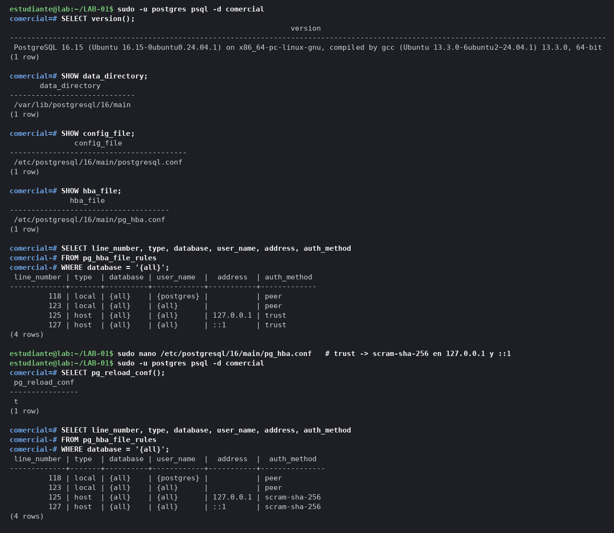

# LAB-01 — Bitácoras y auditoría del dato en PostgreSQL

**Estudiante:** `<Velazquez Espinoza Jose Fernando>` · **Matrícula:** `<16531711>`
**Materia:** Gestión de Seguridad y Desempeño de Bases de Datos · Unidad III · Temas 3.1 y 3.2
**Partes realizadas:** A, B y C (opcional)

## Despliegue del servidor

| Elemento | Valor |
|---|---|
| Forma de despliegue | Instalación nativa en Linux con los paquetes de la distribución (Ubuntu 24.04): `postgresql-16`, `postgresql-client-16`, `postgresql-16-pgaudit` |
| Versión | PostgreSQL 16.15 (Ubuntu 16.15-0ubuntu0.24.04.1), x86_64 |
| Directorio de datos | `/var/lib/postgresql/16/main` |
| `config_file` | `/etc/postgresql/16/main/postgresql.conf` |
| `hba_file` | `/etc/postgresql/16/main/pg_hba.conf` |
| Sesión de administrador | `sudo -u postgres psql -d comercial` (socket Unix, método `peer`) |
| Sesión por red | `psql "postgresql://<usuario>:<contraseña>@127.0.0.1/comercial?application_name=<aplicacion>"` |
| Reinicio / recarga | `sudo pg_ctlcluster 16 main restart` / `SELECT pg_reload_conf();` |
| Zona horaria de la bitácora | `Etc/UTC` (Culiacán = UTC−7) |

Ajuste previo (sección 6.4): las reglas `host` de `127.0.0.1` y `::1` estaban en `trust`; se cambiaron a `scram-sha-256` en `pg_hba.conf` (líneas 125 y 127) y se recargó.



## Contenido

```
LAB-01/
├── README.md
├── informe.md
├── sql/
│   ├── 01-colector-y-vista.sql          Actividad 2
│   ├── 02-configuracion-bitacora.sql    Actividades 4, 5 y 7
│   ├── 03-privilegios-estructura.sql    Actividades 6 y 8
│   ├── 04-esquema-auditoria.sql         Actividad 10
│   ├── 05-funcion-disparador.sql        Actividad 11
│   └── 06-campos-modificados.sql        Actividad 12
└── evidencias/
    ├── 01-configuracion-inicial.md      Actividad 1
    ├── 02-colector.md                   Actividad 2
    ├── 03-incidente-sin-bitacora.md     Actividad 3
    ├── 04-configuracion-bitacora.md     Actividad 4
    ├── 05-accesos.md                    Actividad 5
    ├── 06-privilegios-estructura.md     Actividad 6
    ├── 07-modificaciones.md             Actividad 7
    ├── 08-errores.md                    Actividad 8
    ├── 09-pg-stat-activity.md           Actividad 9
    ├── 10-diseno-auditoria.md           Actividad 10
    ├── 11-incidente-auditado.md         Actividades 11 y 12
    ├── 12-altas-bajas.md                Actividad 13
    ├── 13-manipulacion.md               Actividad 14
    ├── 14-limites.md                    Actividad 15
    ├── 15-cronologia.md                 Actividad 17
    ├── 16-pgaudit.md                    Actividades 18 y 19 (Parte C)
    ├── bitacora-lab01.log               Actividad 16 (contraseña sustituida por <REDACTED>)
    ├── bitacora-lab01.sha256            Actividad 16
    └── capturas/                        Capturas de apoyo de los pasos principales
```

Las capturas complementan, no sustituyen, la bitácora exportada y la interpretación escrita. Todas las contraseñas visibles se sustituyeron por `<REDACTED>`. El servidor no se eliminó: el LAB-03 continúa sobre la misma base.

## Verificación de integridad

```
$ sha256sum -c evidencias/bitacora-lab01.sha256
evidencias/bitacora-lab01.log: OK
```
