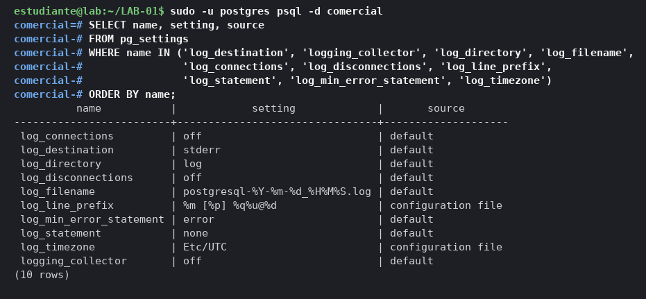

# Evidencia 01 — Configuración de registro por defecto (Actividad 1)

**Estudiante:** `<Nombre completo>` · **Matrícula:** `<Matrícula>`  
**Materia:** Gestión de Seguridad y Desempeño de Bases de Datos · **Unidad III** · **LAB-01**  
**Servidor:** PostgreSQL 16.15 (Ubuntu 24.04, paquetes de la distribución) · base `comercial`  
**Ejecución:** 2026-11-07 UTC (2026-11-06 por la tarde-noche, hora de Culiacán, UTC−7)  
**Sesión de administrador:** `sudo -u postgres psql -d comercial` (socket local, método `peer`)  
Las contraseñas visibles se sustituyeron por `<REDACTED>`.

## Comando ejecutado y resultado

```text
SELECT name, setting, source
FROM pg_settings
WHERE name IN ('log_destination', 'logging_collector', 'log_directory', 'log_filename',
               'log_connections', 'log_disconnections', 'log_line_prefix',
               'log_statement', 'log_min_error_statement', 'log_timezone')
ORDER BY name;
          name           |            setting             |       source
-------------------------+--------------------------------+--------------------
 log_connections         | off                            | default
 log_destination         | stderr                         | default
 log_directory           | log                            | default
 log_disconnections      | off                            | default
 log_filename            | postgresql-%Y-%m-%d_%H%M%S.log | default
 log_line_prefix         | %m [%p] %q%u@%d                | configuration file
 log_min_error_statement | error                          | default
 log_statement           | none                           | default
 log_timezone            | Etc/UTC                        | configuration file
 logging_collector       | off                            | default
(10 rows)
```



## Valores observados

| Parámetro | Valor | Origen | Diferencia con la guía |
|---|---|---|---|
| `logging_collector` | off | default | — |
| `log_destination` | stderr | default | — |
| `log_connections` / `log_disconnections` | off / off | default | — |
| `log_statement` | none | default | — |
| `log_min_error_statement` | error | default | — |
| `log_line_prefix` | `%m [%p] %q%u@%d` | configuration file | El paquete de Ubuntu lo modifica en su `postgresql.conf` (agrega usuario y base, pero no aplicación ni IP) |
| `log_timezone` | Etc/UTC | configuration file | — |

## Respuestas

**1. ¿Se registra quién se conecta?** No. `log_connections` y `log_disconnections` están en `off`, así que ni las conexiones exitosas ni las fallidas dejan línea (una autenticación fallida sí produce un `FATAL`, pero sin la línea `connection received` ni el host de origen en el prefijo).

**2. ¿Se registran las sentencias UPDATE?** No. `log_statement = none` no registra ninguna sentencia; solo se escribiría el texto de una sentencia si provocara un error (`log_min_error_statement = error`).

**3. ¿La línea incluye el usuario o la IP del cliente?** En este servidor el prefijo `%m [%p] %q%u@%d` sí incluye usuario y base de datos, porque Ubuntu cambia el valor por defecto. No incluye la aplicación (`%a`) ni el host o IP del cliente (`%h`). Con el valor por defecto real de PostgreSQL (`%m [%p]`) no aparecería ninguno de los dos.

**4. ¿En qué zona horaria se registran los eventos? ¿Por qué importa?** En `Etc/UTC`. Culiacán está en UTC−7 todo el año, de modo que un evento registrado a las `03:12 UTC` del 7 de noviembre ocurrió a las `20:12` del **6 de noviembre** hora local: incluso cambia la fecha. Al reconstruir una cronología hay que normalizar todas las fuentes (bitácora del servidor, bitácora de la aplicación, reporte de facturación, declaraciones de personas) a una misma zona; de lo contrario se ordenan mal los eventos o se busca evidencia en el día equivocado.

**5. Con `logging_collector = off`, ¿quién decide dónde termina la bitácora?** El mecanismo de despliegue, no PostgreSQL. En este servidor el script `pg_ctlcluster` de Ubuntu redirige stderr a `/var/log/postgresql/postgresql-16-main.log` (visible con `pg_lsclusters`). PostgreSQL no conoce ese archivo: `pg_current_logfile()` devuelve NULL y la rotación, permisos y conservación quedan en manos del sistema operativo.
