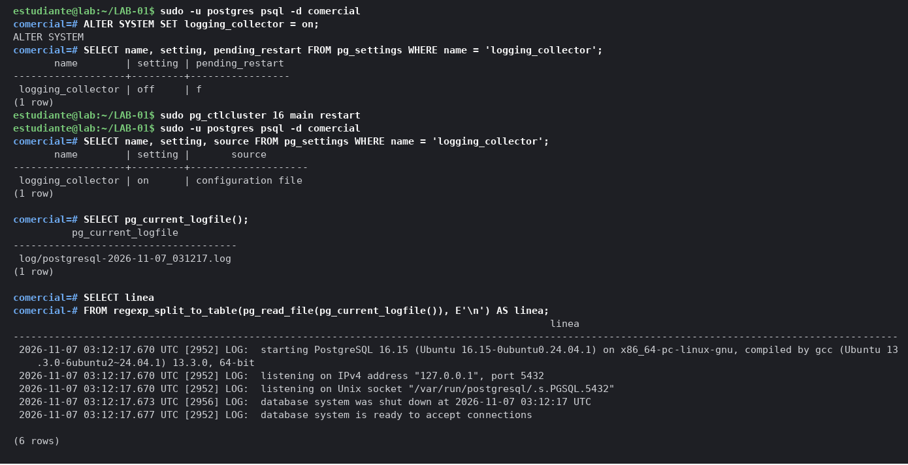

# Evidencia 02 — El servidor administra su propia bitácora (Actividad 2)

**Estudiante:** `<Nombre completo>` · **Matrícula:** `<Matrícula>`  
**Materia:** Gestión de Seguridad y Desempeño de Bases de Datos · **Unidad III** · **LAB-01**  
**Servidor:** PostgreSQL 16.15 (Ubuntu 24.04, paquetes de la distribución) · base `comercial`  
**Ejecución:** 2026-11-07 UTC (2026-11-06 por la tarde-noche, hora de Culiacán, UTC−7)  
**Sesión de administrador:** `sudo -u postgres psql -d comercial` (socket local, método `peer`)  
Las contraseñas visibles se sustituyeron por `<REDACTED>`.

Script: `sql/01-colector-y-vista.sql`

## 1. Activar el colector

```text
ALTER SYSTEM SET logging_collector = on;
ALTER SYSTEM
SELECT name, setting, pending_restart FROM pg_settings WHERE name = 'logging_collector';
       name        | setting | pending_restart
-------------------+---------+-----------------
 logging_collector | off     | f
(1 row)
```

Observación: justo después de `ALTER SYSTEM`, `pending_restart` todavía mostró `f`. El valor se escribe en `postgresql.auto.conf`, pero `pg_settings` solo lo detecta como “pendiente de reinicio” cuando el servidor vuelve a leer sus archivos (recarga). Se reinició el servicio con:

```text
$ sudo pg_ctlcluster 16 main restart
```

## 2. Comprobación, lectura y vista `dba.bitacora`

```text
SELECT name, setting, source FROM pg_settings WHERE name = 'logging_collector';
       name        | setting |       source
-------------------+---------+--------------------
 logging_collector | on      | configuration file
(1 row)

SELECT pg_current_logfile();
          pg_current_logfile
--------------------------------------
 log/postgresql-2026-11-07_031217.log
(1 row)

SELECT linea
FROM regexp_split_to_table(pg_read_file(pg_current_logfile()), E'\n') AS linea;
                                                                                           linea
--------------------------------------------------------------------------------------------------------------------------------------------------------------------------------------------
 2026-11-07 03:12:17.670 UTC [2952] LOG:  starting PostgreSQL 16.15 (Ubuntu 16.15-0ubuntu0.24.04.1) on x86_64-pc-linux-gnu, compiled by gcc (Ubuntu 13.3.0-6ubuntu2~24.04.1) 13.3.0, 64-bit
 2026-11-07 03:12:17.670 UTC [2952] LOG:  listening on IPv4 address "127.0.0.1", port 5432
 2026-11-07 03:12:17.670 UTC [2952] LOG:  listening on Unix socket "/var/run/postgresql/.s.PGSQL.5432"
 2026-11-07 03:12:17.673 UTC [2956] LOG:  database system was shut down at 2026-11-07 03:12:17 UTC
 2026-11-07 03:12:17.677 UTC [2952] LOG:  database system is ready to accept connections

(6 rows)

CREATE SCHEMA dba;
CREATE SCHEMA
REVOKE ALL ON SCHEMA dba FROM PUBLIC;
REVOKE
CREATE VIEW dba.bitacora AS
SELECT t.n AS num, t.linea
FROM regexp_split_to_table(pg_read_file(pg_current_logfile()), E'\n')
     WITH ORDINALITY AS t(linea, n)
WHERE t.linea <> '';
CREATE VIEW
SELECT num, linea FROM dba.bitacora ORDER BY num DESC LIMIT 10;
 num |                                                                                           linea
-----+--------------------------------------------------------------------------------------------------------------------------------------------------------------------------------------------
   5 | 2026-11-07 03:12:17.677 UTC [2952] LOG:  database system is ready to accept connections
   4 | 2026-11-07 03:12:17.673 UTC [2956] LOG:  database system was shut down at 2026-11-07 03:12:17 UTC
   3 | 2026-11-07 03:12:17.670 UTC [2952] LOG:  listening on Unix socket "/var/run/postgresql/.s.PGSQL.5432"
   2 | 2026-11-07 03:12:17.670 UTC [2952] LOG:  listening on IPv4 address "127.0.0.1", port 5432
   1 | 2026-11-07 03:12:17.670 UTC [2952] LOG:  starting PostgreSQL 16.15 (Ubuntu 16.15-0ubuntu0.24.04.1) on x86_64-pc-linux-gnu, compiled by gcc (Ubuntu 13.3.0-6ubuntu2~24.04.1) 13.3.0, 64-bit
(5 rows)

SELECT * FROM pg_ls_logdir();
               name               | size |      modification
----------------------------------+------+------------------------
 postgresql-2026-11-07_031217.log |  565 | 2026-11-07 03:12:17+00
(1 row)
```



La ruta `log/postgresql-2026-11-07_031217.log` es relativa al directorio de datos `/var/lib/postgresql/16/main`. La vista quedó en el esquema `dba`, sin privilegios para `PUBLIC`.

## Respuestas

**1. ¿Por qué `logging_collector` requiere reinicio y `log_statement` solo recarga?** El colector es un proceso auxiliar (*syslogger*) que el proceso principal crea al arrancar, y al crearlo redirige la salida de error de todos los procesos hacia una tubería que ese colector lee. Esa conexión entre procesos solo puede montarse al iniciar el servidor (contexto `postmaster`). `log_statement`, en cambio, es una decisión que cada proceso de sesión toma al ejecutar cada sentencia; basta con que relea la configuración (contexto `superuser`, se aplica con `SIGHUP`/`pg_reload_conf()`).

**2. Ventaja de leer la bitácora con SQL y riesgo que introduce.** Ventaja: funciona igual en cualquier despliegue, no requiere cuenta del sistema operativo ni acceso al contenedor, y permite filtrar, contar y agrupar con SQL (como se hace en el resto del laboratorio). Riesgo: depende de `pg_read_file`, que puede leer cualquier archivo que el proceso `postgres` pueda leer (configuración, claves TLS, etc.), y la vista concentra en un solo lugar todo lo que contiene la bitácora, incluidos secretos y datos personales (Actividad 6). Además, si el servidor está comprometido, la misma vía que lee la evidencia es la que podría usarse para esconderla.

**3. ¿Quién debería consultar `dba.bitacora`?** Solo el DBA y, preferentemente, un rol de auditoría de otra área con permiso exclusivo de lectura. Nunca las cuentas de aplicación (`app_ventas`) ni de soporte (`soporte_ana`). Por eso se ejecutó `REVOKE ALL ON SCHEMA dba FROM PUBLIC`; y como la vista depende de `pg_read_file`, aun con acceso al esquema un rol sin ese privilegio no podría leerla.
