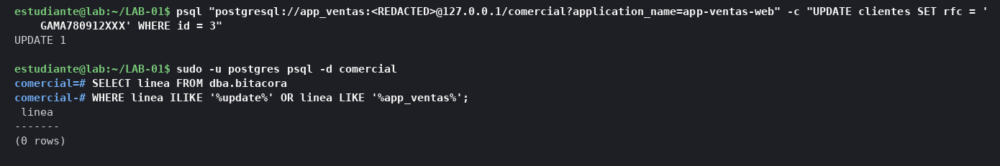

# Evidencia 03 — El incidente sin bitácora (Actividad 3)

**Estudiante:** `<Nombre completo>` · **Matrícula:** `<Matrícula>`  
**Materia:** Gestión de Seguridad y Desempeño de Bases de Datos · **Unidad III** · **LAB-01**  
**Servidor:** PostgreSQL 16.15 (Ubuntu 24.04, paquetes de la distribución) · base `comercial`  
**Ejecución:** 2026-11-07 UTC (2026-11-06 por la tarde-noche, hora de Culiacán, UTC−7)  
**Sesión de administrador:** `sudo -u postgres psql -d comercial` (socket local, método `peer`)  
Las contraseñas visibles se sustituyeron por `<REDACTED>`.

## Comando ejecutado (cuenta de la aplicación, por red)

```text
$ psql "postgresql://app_ventas:<REDACTED>@127.0.0.1/comercial?application_name=app-ventas-web" -c "UPDATE clientes SET rfc = 'GAMA780912XXX' WHERE id = 3"
UPDATE 1
```

## Búsqueda de evidencia (sesión de administrador)

```text
SELECT linea FROM dba.bitacora
WHERE linea ILIKE '%update%' OR linea LIKE '%app_ventas%';
 linea
-------
(0 rows)
```



El cambio de RFC a `GAMA780912XXX` se aplicó (`UPDATE 1`), pero en la bitácora no hay **ninguna** línea del `UPDATE` ni de la conexión de `app_ventas`: solo existe el registro de arranque del servidor.

## Respuestas

**1. ¿Puedes demostrar quién modificó el RFC?** No. No hay registro de la conexión, del usuario, de la IP ni de la sentencia. Solo puede constatarse el estado final del dato.

**2. ¿Puedes demostrar que no lo hizo `soporte_ana`?** Tampoco con evidencia del evento. Lo único que puede argumentarse es que `soporte_ana` solo tiene `SELECT` sobre `clientes` y por lo tanto no *podía* hacerlo con su propia cuenta. Eso es una conclusión sobre permisos, no sobre hechos: no descarta que alguien haya usado otra cuenta (por ejemplo, las credenciales de `app_ventas`).

**3. ¿Los privilegios de la Unidad II impidieron el cambio? ¿Debían impedirlo?** No lo impidieron, y no debían: `app_ventas` tiene `UPDATE` sobre `clientes` porque actualizar clientes es su función legítima. El control de acceso decide quién *puede*; no distingue un uso legítimo de un error o un abuso, ni deja constancia de lo que se hizo.

**4. ¿Qué tendría que haber estado configurado antes del incidente?** Como mínimo: colector de bitácora, `log_connections`/`log_disconnections`, un `log_line_prefix` con usuario, base, aplicación e IP, `log_statement = mod`, y una auditoría a nivel de dato que conserve el valor anterior (Parte B). Todo eso **antes** del evento.

> Lo que no se registró en su momento no puede reconstruirse. Este cambio a `GAMA780912XXX` queda como un hueco permanente en la cronología.
