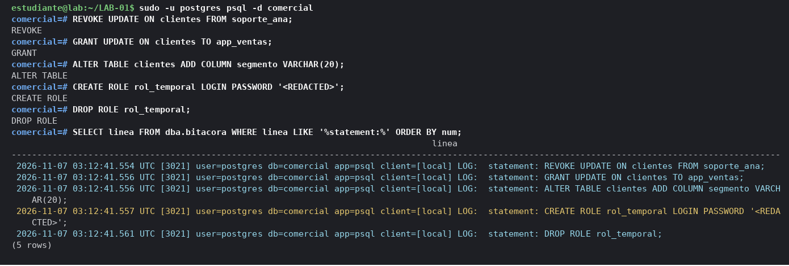

# Evidencia 06 — Cambios de privilegios y de estructura (Actividad 6)

**Estudiante:** `<Nombre completo>` · **Matrícula:** `<Matrícula>`  
**Materia:** Gestión de Seguridad y Desempeño de Bases de Datos · **Unidad III** · **LAB-01**  
**Servidor:** PostgreSQL 16.15 (Ubuntu 24.04, paquetes de la distribución) · base `comercial`  
**Ejecución:** 2026-11-07 UTC (2026-11-06 por la tarde-noche, hora de Culiacán, UTC−7)  
**Sesión de administrador:** `sudo -u postgres psql -d comercial` (socket local, método `peer`)  
Las contraseñas visibles se sustituyeron por `<REDACTED>`.

Script: `sql/03-privilegios-estructura.sql`

## Sentencias y bitácora (`log_statement = 'ddl'`)

```text
REVOKE UPDATE ON clientes FROM soporte_ana;
REVOKE
GRANT UPDATE ON clientes TO app_ventas;
GRANT
ALTER TABLE clientes ADD COLUMN segmento VARCHAR(20);
ALTER TABLE
CREATE ROLE rol_temporal LOGIN PASSWORD '<REDACTED>';
CREATE ROLE
DROP ROLE rol_temporal;
DROP ROLE
SELECT linea FROM dba.bitacora WHERE linea LIKE '%statement:%' ORDER BY num;
                                                                                  linea
--------------------------------------------------------------------------------------------------------------------------------------------------------------------------
 2026-11-07 03:12:41.554 UTC [3021] user=postgres db=comercial app=psql client=[local] LOG:  statement: REVOKE UPDATE ON clientes FROM soporte_ana;
 2026-11-07 03:12:41.556 UTC [3021] user=postgres db=comercial app=psql client=[local] LOG:  statement: GRANT UPDATE ON clientes TO app_ventas;
 2026-11-07 03:12:41.556 UTC [3021] user=postgres db=comercial app=psql client=[local] LOG:  statement: ALTER TABLE clientes ADD COLUMN segmento VARCHAR(20);
 2026-11-07 03:12:41.557 UTC [3021] user=postgres db=comercial app=psql client=[local] LOG:  statement: CREATE ROLE rol_temporal LOGIN PASSWORD '<REDACTED>';
 2026-11-07 03:12:41.561 UTC [3021] user=postgres db=comercial app=psql client=[local] LOG:  statement: DROP ROLE rol_temporal;
(5 rows)
```



La contraseña de `rol_temporal` quedó **en texto claro** en la bitácora (aquí y en el archivo exportado se sustituyó por `<REDACTED>`). El `DROP ROLE` posterior no la borra.

## Respuestas

**1. Tipo de evento de las tres primeras sentencias.**

| Sentencia | Tipo |
|---|---|
| `REVOKE UPDATE ON clientes FROM soporte_ana` | Privilegio |
| `GRANT UPDATE ON clientes TO app_ventas` | Privilegio |
| `ALTER TABLE clientes ADD COLUMN segmento VARCHAR(20)` | Estructura |

**2. ¿Por qué `GRANT` y `REVOKE` quedan registrados con `ddl`?** PostgreSQL clasifica todas las sentencias que no son de consulta ni de modificación de filas como sentencias de definición: `CREATE`, `ALTER`, `DROP`, y también `GRANT`, `REVOKE`, `COMMENT` y `CREATE/ALTER ROLE` (que modifican el catálogo del sistema). El manual lo indica para `log_statement = ddl`. Por eso `ddl` ya cubre los cambios de privilegio, que son de los eventos más relevantes para seguridad.

**3. Si la bitácora contiene contraseñas, ¿quién debería leerla?** Debe tratarse como un depósito de secretos: acceso mínimo (DBA y custodio de auditoría), archivo con permisos restringidos, exportaciones depuradas, y conservación protegida. Y, sobre todo, evitar que el secreto llegue a la bitácora: asignar contraseñas con `\password` (el cliente calcula el resumen SCRAM y el servidor solo recibe `SCRAM-SHA-256$4096:...`), o desde un gestor de secretos, como se trabajó en la Unidad II. Aun el resumen SCRAM es sensible porque permitiría un ataque de diccionario fuera de línea.
