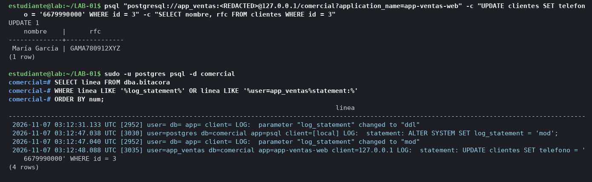

# Evidencia 07 — Modificaciones de datos: `ddl` frente a `mod` (Actividad 7)

**Estudiante:** `<Nombre completo>` · **Matrícula:** `<Matrícula>`  
**Materia:** Gestión de Seguridad y Desempeño de Bases de Datos · **Unidad III** · **LAB-01**  
**Servidor:** PostgreSQL 16.15 (Ubuntu 24.04, paquetes de la distribución) · base `comercial`  
**Ejecución:** 2026-11-07 UTC (2026-11-06 por la tarde-noche, hora de Culiacán, UTC−7)  
**Sesión de administrador:** `sudo -u postgres psql -d comercial` (socket local, método `peer`)  
Las contraseñas visibles se sustituyeron por `<REDACTED>`.

## 1. UPDATE con `log_statement = 'ddl'`

```text
$ psql "postgresql://app_ventas:<REDACTED>@127.0.0.1/comercial?application_name=app-ventas-web" -c "UPDATE clientes SET rfc = 'GAMA780912XYZ' WHERE id = 3"
UPDATE 1
```

```text
SELECT linea FROM dba.bitacora WHERE linea LIKE '%user=app_ventas%' ORDER BY num DESC LIMIT 3;
                                                                                                                                 linea
------------------------------------------------------------------------------------------------------------------------------------------------------------------------------------------------------------------------------------------------------------------------
 2026-11-07 03:12:47.009 UTC [3026] user=app_ventas db=comercial app=app-ventas-web client=127.0.0.1 LOG:  disconnection: session time: 0:00:00.010 user=app_ventas database=comercial host=127.0.0.1 port=43816
 2026-11-07 03:12:47.006 UTC [3026] user=app_ventas db=comercial app=[unknown] client=127.0.0.1 LOG:  connection authorized: user=app_ventas database=comercial application_name=app-ventas-web SSL enabled (protocol=TLSv1.3, cipher=TLS_AES_256_GCM_SHA384, bits=256)
 2026-11-07 03:12:47.006 UTC [3026] user=app_ventas db=comercial app=[unknown] client=127.0.0.1 LOG:  connection authenticated: identity="app_ventas" method=scram-sha-256 (/etc/postgresql/16/main/pg_hba.conf:125)
(3 rows)

ALTER SYSTEM SET log_statement = 'mod';
ALTER SYSTEM
SELECT pg_reload_conf();
 pg_reload_conf
----------------
 t
(1 row)
```

Aparecen la autenticación, la autorización y la desconexión de `app_ventas` (PID 3026), pero **no** el `UPDATE` que cambió el RFC a `GAMA780912XYZ`.

## 2. UPDATE y SELECT con `log_statement = 'mod'`

```text
$ psql "postgresql://app_ventas:<REDACTED>@127.0.0.1/comercial?application_name=app-ventas-web" -c "UPDATE clientes SET telefono = '6679990000' WHERE id = 3" -c "SELECT nombre, rfc FROM clientes WHERE id = 3"
UPDATE 1
    nombre    |      rfc
--------------+---------------
 María García | GAMA780912XYZ
(1 row)
```

```text
SELECT linea FROM dba.bitacora
WHERE linea LIKE '%log_statement%' OR linea LIKE '%user=app_ventas%statement:%'
ORDER BY num;
                                                                                     linea
-------------------------------------------------------------------------------------------------------------------------------------------------------------------------------
 2026-11-07 03:12:31.133 UTC [2952] user= db= app= client= LOG:  parameter "log_statement" changed to "ddl"
 2026-11-07 03:12:47.038 UTC [3030] user=postgres db=comercial app=psql client=[local] LOG:  statement: ALTER SYSTEM SET log_statement = 'mod';
 2026-11-07 03:12:47.040 UTC [2952] user= db= app= client= LOG:  parameter "log_statement" changed to "mod"
 2026-11-07 03:12:48.088 UTC [3035] user=app_ventas db=comercial app=app-ventas-web client=127.0.0.1 LOG:  statement: UPDATE clientes SET telefono = '6679990000' WHERE id = 3
(4 rows)
```



## Análisis

- Con `mod` aparece la sentencia completa con quién (`user=app_ventas`), cuándo (`03:12:48.088 UTC`), desde dónde (`client=127.0.0.1`) y con qué aplicación (`app=app-ventas-web`).
- El `SELECT nombre, rfc` de la misma sesión **no** aparece: `mod` no registra lecturas.
- La línea dice que el teléfono pasó a `6679990000`, pero no qué valor tenía antes (`6673456789`, que solo se conoce porque está en el script de carga).
- El `ALTER SYSTEM SET log_statement = 'mod'` sí quedó registrado (PID 3030), porque en ese momento ya regía `ddl`.

## Respuestas

**1. ¿Qué nivel habría registrado la lectura del RFC? ¿Qué costo tendría?** Solo `log_statement = 'all'`. En un servidor con miles de consultas por minuto, eso son miles de líneas por minuto: más escritura en disco, archivos que rotan rápido, más espacio de almacenamiento y de respaldo, y más dificultad para encontrar lo relevante. Además, cada consulta que incluya datos en el `WHERE` (un RFC, un correo) los copia a la bitácora, que se convierte en otro depósito de datos personales.

**2. ¿Qué le falta a esta bitácora para revertir el cambio con certeza?** El **valor anterior** de cada registro. Registra la sentencia, no su efecto: no dice qué filas tocó ni qué contenían antes. Con un `UPDATE` sin `WHERE` tampoco diría cuántas filas cambió. Hace falta una auditoría a nivel de dato (Parte B).
