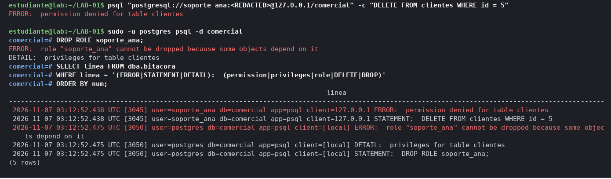

# Evidencia 08 — Errores y operaciones rechazadas (Actividad 8)

**Estudiante:** `<Nombre completo>` · **Matrícula:** `<Matrícula>`  
**Materia:** Gestión de Seguridad y Desempeño de Bases de Datos · **Unidad III** · **LAB-01**  
**Servidor:** PostgreSQL 16.15 (Ubuntu 24.04, paquetes de la distribución) · base `comercial`  
**Ejecución:** 2026-11-07 UTC (2026-11-06 por la tarde-noche, hora de Culiacán, UTC−7)  
**Sesión de administrador:** `sudo -u postgres psql -d comercial` (socket local, método `peer`)  
Las contraseñas visibles se sustituyeron por `<REDACTED>`.

## Intento de borrado por `soporte_ana`

```text
$ psql "postgresql://soporte_ana:<REDACTED>@127.0.0.1/comercial" -c "DELETE FROM clientes WHERE id = 5"
ERROR:  permission denied for table clientes
```

## Baja del rol y búsqueda en la bitácora

```text
DROP ROLE soporte_ana;
ERROR:  role "soporte_ana" cannot be dropped because some objects depend on it
DETAIL:  privileges for table clientes
SELECT linea FROM dba.bitacora
WHERE linea ~ '(ERROR|STATEMENT|DETAIL):  (permission|privileges|role|DELETE|DROP)'
ORDER BY num;
                                                                                linea
----------------------------------------------------------------------------------------------------------------------------------------------------------------------
 2026-11-07 03:12:52.438 UTC [3045] user=soporte_ana db=comercial app=psql client=127.0.0.1 ERROR:  permission denied for table clientes
 2026-11-07 03:12:52.438 UTC [3045] user=soporte_ana db=comercial app=psql client=127.0.0.1 STATEMENT:  DELETE FROM clientes WHERE id = 5
 2026-11-07 03:12:52.475 UTC [3050] user=postgres db=comercial app=psql client=[local] ERROR:  role "soporte_ana" cannot be dropped because some objects depend on it
 2026-11-07 03:12:52.475 UTC [3050] user=postgres db=comercial app=psql client=[local] DETAIL:  privileges for table clientes
 2026-11-07 03:12:52.475 UTC [3050] user=postgres db=comercial app=psql client=[local] STATEMENT:  DROP ROLE soporte_ana;
(5 rows)
```



Las líneas `STATEMENT:` existen gracias a `log_min_error_statement = error`, independientemente de `log_statement`. Además, como ya regía `mod`, el `DELETE` de `soporte_ana` también quedó como `statement:` **antes** de ejecutarse (línea 69 del archivo exportado), y luego su `ERROR` (línea 70).

## Respuestas

**1. ¿El intento de `soporte_ana` causó daño? ¿Por qué auditarlo?** No causó daño: el `DELETE` fue rechazado y el registro `id = 5` sigue existiendo. Debe auditarse porque muestra una **intención** o un error de uso fuera del rol asignado: soporte solo consulta. Puede ser un error inocente, un sondeo de permisos o el primer paso de un abuso; varios intentos así son un indicador temprano. También demuestra que el control de acceso funcionó.

**2. Diferencia entre error de autorización y de autenticación.**

| | Autenticación (Actividad 5) | Autorización (esta actividad) |
|---|---|---|
| Pregunta | ¿Eres quien dices ser? | ¿Puedes hacer esto? |
| Momento | Al conectar, antes de existir la sesión | Con la sesión establecida, al ejecutar una sentencia |
| Severidad | `FATAL` (la conexión se cierra) | `ERROR` (la sesión continúa) |
| Identidad | Solo el nombre que presentó el cliente | Usuario ya verificado con su contraseña |

**3. ¿Qué indica el error de `DROP ROLE` sobre el orden para dar de baja a un usuario?** Un rol no puede eliminarse mientras tenga privilegios u objetos que dependan de él. El orden correcto es retirar primero lo que depende del rol y al final eliminarlo: `REVOKE` de sus privilegios (o `DROP OWNED BY`, que también los retira), `REASSIGN OWNED BY ... TO <nuevo propietario>` para los objetos que posea, y luego `DROP ROLE`. Antes conviene deshabilitar el acceso (`ALTER ROLE ... NOLOGIN`) para que no pueda conectarse durante el proceso. No se ejecutó la baja porque el LAB-03 continúa con este rol.
