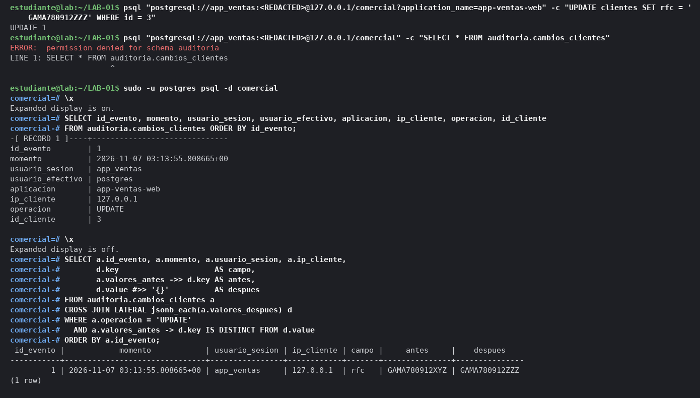

# Evidencia 11 — Función, disparador e incidente auditado (Actividades 11 y 12)

**Estudiante:** `<Nombre completo>` · **Matrícula:** `<Matrícula>`  
**Materia:** Gestión de Seguridad y Desempeño de Bases de Datos · **Unidad III** · **LAB-01**  
**Servidor:** PostgreSQL 16.15 (Ubuntu 24.04, paquetes de la distribución) · base `comercial`  
**Ejecución:** 2026-11-07 UTC (2026-11-06 por la tarde-noche, hora de Culiacán, UTC−7)  
**Sesión de administrador:** `sudo -u postgres psql -d comercial` (socket local, método `peer`)  
Las contraseñas visibles se sustituyeron por `<REDACTED>`.

Scripts: `sql/05-funcion-disparador.sql`, `sql/06-campos-modificados.sql`

## Actividad 11 — Función y disparador

```text
-- LAB-01 · Actividad 11 · Función de auditoría y disparador sobre clientes
-- SECURITY DEFINER: se ejecuta con privilegios del propietario (postgres),
-- así app_ventas provoca la escritura en auditoria sin poder escribir en ella.
-- search_path fijo: evita que un usuario suplante objetos desde otro esquema.
CREATE OR REPLACE FUNCTION auditoria.registrar_cambio_cliente()
RETURNS trigger
LANGUAGE plpgsql
SECURITY DEFINER
SET search_path = pg_catalog, public
AS $$
BEGIN
    IF TG_OP = 'INSERT' THEN
        INSERT INTO auditoria.cambios_clientes (operacion, id_cliente, valores_despues)
        VALUES (TG_OP, NEW.id, to_jsonb(NEW));
        RETURN NEW;
    ELSIF TG_OP = 'UPDATE' THEN
        INSERT INTO auditoria.cambios_clientes (operacion, id_cliente, valores_antes, valores_despues)
        VALUES (TG_OP, NEW.id, to_jsonb(OLD), to_jsonb(NEW));
        RETURN NEW;
    ELSIF TG_OP = 'DELETE' THEN
        INSERT INTO auditoria.cambios_clientes (operacion, id_cliente, valores_antes)
        VALUES (TG_OP, OLD.id, to_jsonb(OLD));
        RETURN OLD;
    END IF;
    RETURN NULL;
END;
$$;
CREATE FUNCTION
REVOKE ALL ON FUNCTION auditoria.registrar_cambio_cliente() FROM PUBLIC;
REVOKE
CREATE TRIGGER trg_auditoria_clientes
AFTER INSERT OR UPDATE OR DELETE ON clientes
FOR EACH ROW EXECUTE FUNCTION auditoria.registrar_cambio_cliente();
CREATE TRIGGER
-- Verificación
SELECT tgname, tgenabled, tgrelid::regclass FROM pg_trigger WHERE NOT tgisinternal;
         tgname         | tgenabled | tgrelid
------------------------+-----------+----------
 trg_auditoria_clientes | O         | clientes
(1 row)
```

`tgenabled = O`: el disparador está habilitado. La creación quedó en la bitácora:

```text
SELECT linea FROM dba.bitacora
WHERE linea ~ 'statement: (CREATE|REVOKE)' AND linea ~ '(auditoria|trg_)'
ORDER BY num;
                                                                                      linea
---------------------------------------------------------------------------------------------------------------------------------------------------------------------------------
 2026-11-07 03:13:46.558 UTC [3094] user=postgres db=comercial app=psql client=[local] LOG:  statement: CREATE SCHEMA auditoria;
 2026-11-07 03:13:46.559 UTC [3094] user=postgres db=comercial app=psql client=[local] LOG:  statement: REVOKE ALL ON SCHEMA auditoria FROM PUBLIC;
 2026-11-07 03:13:46.559 UTC [3094] user=postgres db=comercial app=psql client=[local] LOG:  statement: CREATE TABLE auditoria.cambios_clientes (
 2026-11-07 03:13:46.597 UTC [3100] user=postgres db=comercial app=psql client=[local] LOG:  statement: CREATE OR REPLACE FUNCTION auditoria.registrar_cambio_cliente()
 2026-11-07 03:13:46.599 UTC [3100] user=postgres db=comercial app=psql client=[local] LOG:  statement: REVOKE ALL ON FUNCTION auditoria.registrar_cambio_cliente() FROM PUBLIC;
 2026-11-07 03:13:46.600 UTC [3100] user=postgres db=comercial app=psql client=[local] LOG:  statement: CREATE TRIGGER trg_auditoria_clientes
(6 rows)
```

### Respuestas de la Actividad 11

**1. ¿Por qué `REVOKE ALL ON FUNCTION ... FROM PUBLIC` si el disparador sigue funcionando para `app_ventas`?** Al ejecutar un disparador, PostgreSQL no verifica el privilegio `EXECUTE` del usuario que hace el `UPDATE`; solo lo exige a quien **crea** un disparador con esa función. Toda función nueva concede `EXECUTE` a `PUBLIC` por defecto, así que, sin el `REVOKE`, cualquier rol que tuviera una tabla propia podría colgarle esta función `SECURITY DEFINER` y escribir filas falsas en `auditoria.cambios_clientes` con privilegios de `postgres`. El `REVOKE` aplica mínimo privilegio sin afectar el funcionamiento.

**2. Hipótesis: ¿qué pasaría sin `SECURITY DEFINER`?** La función se ejecutaría con los privilegios de `app_ventas`, que no tiene `USAGE` en el esquema `auditoria`. El `INSERT` de auditoría fallaría con `permission denied for schema auditoria` y, como el disparador corre dentro de la misma transacción, **todo el `UPDATE` se revertiría**: la aplicación dejaría de poder actualizar clientes. La única “solución” sería darle a la aplicación permiso de escribir en la auditoría, lo que le permitiría también falsificarla.

**3. ¿Quedó registrada la creación del esquema, la tabla, la función y el disparador?** Sí (líneas 105–147 del archivo exportado), porque `log_statement = 'mod'` incluye todo lo de `ddl`. Para sentencias de varias líneas, la bitácora conserva el texto completo; la consulta muestra solo la primera línea.

## Actividad 12 — El incidente auditado

```text
$ psql "postgresql://app_ventas:<REDACTED>@127.0.0.1/comercial?application_name=app-ventas-web" -c "UPDATE clientes SET rfc = 'GAMA780912ZZZ' WHERE id = 3"
UPDATE 1
$ psql "postgresql://app_ventas:<REDACTED>@127.0.0.1/comercial" -c "SELECT * FROM auditoria.cambios_clientes"
ERROR:  permission denied for schema auditoria
LINE 1: SELECT * FROM auditoria.cambios_clientes
                      ^
```

```text
\x
Expanded display is on.
SELECT id_evento, momento, usuario_sesion, usuario_efectivo, aplicacion, ip_cliente, operacion, id_cliente
FROM auditoria.cambios_clientes ORDER BY id_evento;
-[ RECORD 1 ]----+------------------------------
id_evento        | 1
momento          | 2026-11-07 03:13:55.808665+00
usuario_sesion   | app_ventas
usuario_efectivo | postgres
aplicacion       | app-ventas-web
ip_cliente       | 127.0.0.1
operacion        | UPDATE
id_cliente       | 3

\x
Expanded display is off.
```

```text
SELECT a.id_evento, a.momento, a.usuario_sesion, a.ip_cliente,
       d.key                     AS campo,
       a.valores_antes ->> d.key AS antes,
       d.value #>> '{}'          AS despues
FROM auditoria.cambios_clientes a
CROSS JOIN LATERAL jsonb_each(a.valores_despues) d
WHERE a.operacion = 'UPDATE'
  AND a.valores_antes -> d.key IS DISTINCT FROM d.value
ORDER BY a.id_evento;
 id_evento |            momento            | usuario_sesion | ip_cliente | campo |     antes     |    despues
-----------+-------------------------------+----------------+------------+-------+---------------+---------------
         1 | 2026-11-07 03:13:55.808665+00 | app_ventas     | 127.0.0.1  | rfc   | GAMA780912XYZ | GAMA780912ZZZ
(1 row)
```



### Respuestas de la Actividad 12

**1. Comparación con la hipótesis.** El `UPDATE` de `app_ventas` funcionó (`UPDATE 1`) y se auditó, mientras que la consulta directa a la auditoría con la misma cuenta fue rechazada (`permission denied for schema auditoria`). Esto confirma la hipótesis: la aplicación no tiene acceso al esquema, y solo gracias a `SECURITY DEFINER` el disparador escribe allí. También se confirma el papel de `session_user`: `usuario_sesion = app_ventas` identifica a quien provocó el cambio, mientras que `usuario_efectivo = postgres` solo refleja al propietario de la función. Si la auditoría usara `current_user`, todos los cambios parecerían hechos por `postgres`.

**2. Sentencia que restauraría el valor anterior.**

```sql
UPDATE clientes SET rfc = 'GAMA780912XYZ' WHERE id = 3;
```

Forma genérica, tomando el valor de la propia auditoría (también queda auditada):

```sql
UPDATE clientes c
SET rfc = a.valores_antes ->> 'rfc'
FROM auditoria.cambios_clientes a
WHERE a.id_evento = 1 AND c.id = a.id_cliente;
```

Nota: `GAMA780912XYZ` tampoco era el valor original (`GAMA780912GHI`); la cadena de cambios anteriores a la auditoría (Actividades 3 y 7) no puede reconstruirse con esta tabla.

**3. ¿Qué columna tiene más valor: `aplicacion` o `ip_cliente`? ¿Cuál se falsifica con más facilidad?** `ip_cliente` tiene más valor: la toma el servidor de la conexión TCP ya establecida, y falsificarla requiere control de la red. `application_name` lo escribe libremente el cliente en la cadena de conexión: cualquiera con las credenciales puede presentarse como `app-ventas-web`. Aun así, la IP tiene límites: detrás de un NAT, un proxy o un *pool* de conexiones identifica al intermediario, no a la persona.
