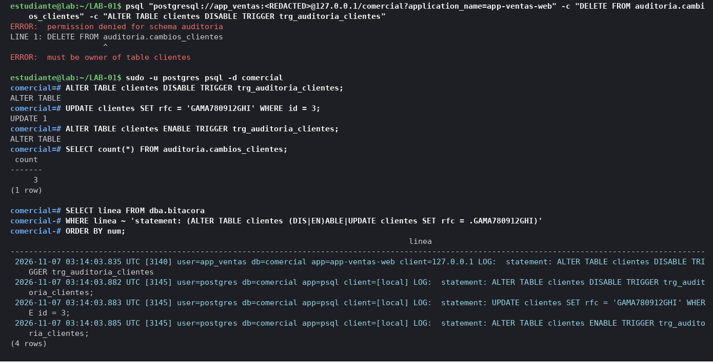

# Evidencia 13 — Intento de manipular la auditoría (Actividad 14)

**Estudiante:** `<Nombre completo>` · **Matrícula:** `<Matrícula>`  
**Materia:** Gestión de Seguridad y Desempeño de Bases de Datos · **Unidad III** · **LAB-01**  
**Servidor:** PostgreSQL 16.15 (Ubuntu 24.04, paquetes de la distribución) · base `comercial`  
**Ejecución:** 2026-11-07 UTC (2026-11-06 por la tarde-noche, hora de Culiacán, UTC−7)  
**Sesión de administrador:** `sudo -u postgres psql -d comercial` (socket local, método `peer`)  
Las contraseñas visibles se sustituyeron por `<REDACTED>`.

## Desde la cuenta de la aplicación

```text
$ psql "postgresql://app_ventas:<REDACTED>@127.0.0.1/comercial?application_name=app-ventas-web" -c "DELETE FROM auditoria.cambios_clientes" -c "ALTER TABLE clientes DISABLE TRIGGER trg_auditoria_clientes"
ERROR:  permission denied for schema auditoria
LINE 1: DELETE FROM auditoria.cambios_clientes
                    ^
ERROR:  must be owner of table clientes
```

## Desde la cuenta de administrador

```text
ALTER TABLE clientes DISABLE TRIGGER trg_auditoria_clientes;
ALTER TABLE
UPDATE clientes SET rfc = 'GAMA780912GHI' WHERE id = 3;
UPDATE 1
ALTER TABLE clientes ENABLE TRIGGER trg_auditoria_clientes;
ALTER TABLE
SELECT count(*) FROM auditoria.cambios_clientes;
 count
-------
     3
(1 row)

SELECT linea FROM dba.bitacora
WHERE linea ~ 'statement: (ALTER TABLE clientes (DIS|EN)ABLE|UPDATE clientes SET rfc = .GAMA780912GHI)'
ORDER BY num;
                                                                                      linea
----------------------------------------------------------------------------------------------------------------------------------------------------------------------------------
 2026-11-07 03:14:03.835 UTC [3140] user=app_ventas db=comercial app=app-ventas-web client=127.0.0.1 LOG:  statement: ALTER TABLE clientes DISABLE TRIGGER trg_auditoria_clientes
 2026-11-07 03:14:03.882 UTC [3145] user=postgres db=comercial app=psql client=[local] LOG:  statement: ALTER TABLE clientes DISABLE TRIGGER trg_auditoria_clientes;
 2026-11-07 03:14:03.883 UTC [3145] user=postgres db=comercial app=psql client=[local] LOG:  statement: UPDATE clientes SET rfc = 'GAMA780912GHI' WHERE id = 3;
 2026-11-07 03:14:03.885 UTC [3145] user=postgres db=comercial app=psql client=[local] LOG:  statement: ALTER TABLE clientes ENABLE TRIGGER trg_auditoria_clientes;
(4 rows)
```



El conteo siguió en 3: el cambio de RFC a `GAMA780912GHI` no quedó en la tabla de auditoría. La bitácora sí registró el intento fallido de `app_ventas` (con `mod`, la sentencia se registra antes de ejecutarse; su `ERROR: must be owner of table clientes` está en la línea 188) y la secuencia completa del administrador: `DISABLE`, `UPDATE`, `ENABLE`, todo en el PID 3145 en menos de 3 ms.

## Detección del hueco desde la propia auditoría

Además de la bitácora, el hueco puede detectarse dentro de la tabla de auditoría: el `valores_despues` de un evento debe coincidir con el `valores_antes` del siguiente evento del mismo cliente. Consulta ejecutada al final del laboratorio:

```text
-- Detección de cambios no auditados: el "después" de un evento debe coincidir con el "antes" del siguiente
SELECT id_cliente, anterior, siguiente, campo, despues_registrado, antes_siguiente
FROM (
  SELECT a.id_cliente, a.id_evento AS anterior,
         lead(a.id_evento)     OVER w AS siguiente,
         a.valores_despues            AS d,
         lead(a.valores_antes) OVER w AS s
  FROM auditoria.cambios_clientes a
  WINDOW w AS (PARTITION BY a.id_cliente ORDER BY a.id_evento)
) x
CROSS JOIN LATERAL jsonb_each_text(x.d) c(campo, despues_registrado)
CROSS JOIN LATERAL (SELECT x.s ->> c.campo AS antes_siguiente) y
WHERE x.s IS NOT NULL
  AND c.campo <> 'segmento'
  AND c.despues_registrado IS DISTINCT FROM y.antes_siguiente
ORDER BY 1, 2;
 id_cliente | anterior | siguiente | campo | despues_registrado | antes_siguiente
------------+----------+-----------+-------+--------------------+-----------------
          3 |        1 |         8 | rfc   | GAMA780912ZZZ      | GAMA780912GHI
(1 row)
```

El evento 1 dejó el RFC en `GAMA780912ZZZ`, pero el siguiente evento de ese cliente (el 8, generado por el `UPDATE` masivo de la Actividad 15) lo recibió como `GAMA780912GHI`. Entre ambos hubo un cambio que no pasó por el disparador.

## Respuestas

**1. ¿Qué evidencia permite detectar el cambio sin auditar?** Las líneas de la bitácora con `ALTER TABLE clientes DISABLE TRIGGER` y `ENABLE TRIGGER` del usuario `postgres`, con el `UPDATE` intermedio y su hora exacta. Y la discontinuidad entre eventos consecutivos de la tabla de auditoría, que es detectable aunque nadie revise la bitácora.

**2. ¿Qué control administrativo reduciría este riesgo?** Un procedimiento de gestión de cambios: cualquier desactivación de un disparador de auditoría o cambio de parámetros de registro en producción debe tener una solicitud aprobada por alguien distinto de quien la ejecuta. Lo complementan la revisión periódica, por un área independiente, de los eventos `DISABLE TRIGGER` y `parameter ... changed`; el uso de cuentas nominales para los administradores, en lugar del `postgres` compartido; y el envío de la bitácora a un sistema externo custodiado por otra área.

**3. Relación con la separación de funciones de la Unidad II.** En la Unidad II se separaron funciones para que ningún rol tuviera más privilegios de los necesarios (la aplicación actualiza, soporte consulta). Aquí el mismo principio se aplica al mecanismo de auditoría: quien opera la base no debe ser quien custodia la evidencia de su propia operación. La prueba lo muestra: `app_ventas` no pudo borrar la auditoría ni desactivar el disparador, porque está separada; `postgres` sí pudo, porque concentra ambas funciones. Ningún control dentro del servidor protege contra quien tiene control total del servidor.
