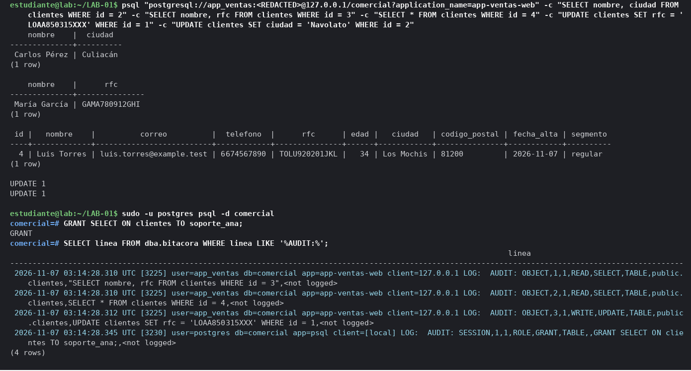

# Evidencia 16 — pgaudit: auditoría de objeto (Actividades 18 y 19, Parte C opcional)

**Estudiante:** `<Nombre completo>` · **Matrícula:** `<Matrícula>`  
**Materia:** Gestión de Seguridad y Desempeño de Bases de Datos · **Unidad III** · **LAB-01**  
**Servidor:** PostgreSQL 16.15 (Ubuntu 24.04, paquetes de la distribución) · base `comercial`  
**Ejecución:** 2026-11-07 UTC (2026-11-06 por la tarde-noche, hora de Culiacán, UTC−7)  
**Sesión de administrador:** `sudo -u postgres psql -d comercial` (socket local, método `peer`)  
Las contraseñas visibles se sustituyeron por `<REDACTED>`.

Se realizó después de exportar la bitácora (Actividad 16), porque el reinicio inicia un archivo nuevo (`log/postgresql-2026-11-07_031418.log`).

## Actividad 18 — Instalación y carga

Paquete instalado en el mismo servidor: `sudo apt install postgresql-16-pgaudit` (versión de la extensión **16.0** en Ubuntu 24.04; la guía muestra 16.1 de PGDG).

```text
SELECT name, default_version FROM pg_available_extensions WHERE name = 'pgaudit';
  name   | default_version
---------+-----------------
 pgaudit | 16.0
(1 row)

CREATE EXTENSION pgaudit;
ERROR:  pgaudit must be loaded via shared_preload_libraries
ALTER SYSTEM SET shared_preload_libraries = 'pgaudit';
ALTER SYSTEM
SELECT pg_reload_conf();
 pg_reload_conf
----------------
 t
(1 row)
```

```text
SELECT name, setting, pending_restart FROM pg_settings WHERE name = 'shared_preload_libraries';
           name           | setting | pending_restart
--------------------------+---------+-----------------
 shared_preload_libraries |         | t
(1 row)
```

```text
$ sudo pg_ctlcluster 16 main restart
```

```text
SHOW shared_preload_libraries;
 shared_preload_libraries
--------------------------
 pgaudit
(1 row)

CREATE EXTENSION pgaudit;
CREATE EXTENSION
SELECT extname, extversion FROM pg_extension WHERE extname = 'pgaudit';
 extname | extversion
---------+------------
 pgaudit | 16.0
(1 row)

SELECT pg_current_logfile();
          pg_current_logfile
--------------------------------------
 log/postgresql-2026-11-07_031418.log
(1 row)
```

## Actividad 19 — Rol auditor sobre columnas sensibles

```text
CREATE ROLE auditor_datos NOLOGIN;
CREATE ROLE
GRANT SELECT (rfc, telefono), UPDATE (rfc, telefono) ON clientes TO auditor_datos;
GRANT
ALTER SYSTEM SET pgaudit.log = 'role, ddl';
ALTER SYSTEM
ALTER SYSTEM SET pgaudit.role = 'auditor_datos';
ALTER SYSTEM
ALTER SYSTEM SET pgaudit.log_relation = on;
ALTER SYSTEM
SELECT pg_reload_conf();
 pg_reload_conf
----------------
 t
(1 row)
```

```text
$ psql "postgresql://app_ventas:<REDACTED>@127.0.0.1/comercial?application_name=app-ventas-web" -c "SELECT nombre, ciudad FROM clientes WHERE id = 2" -c "SELECT nombre, rfc FROM clientes WHERE id = 3" -c "SELECT * FROM clientes WHERE id = 4" -c "UPDATE clientes SET rfc = 'LOAA850315XXX' WHERE id = 1" -c "UPDATE clientes SET ciudad = 'Navolato' WHERE id = 2"
    nombre    |  ciudad
--------------+----------
 Carlos Pérez | Culiacán
(1 row)

    nombre    |      rfc
--------------+---------------
 María García | GAMA780912GHI
(1 row)

 id |   nombre    |          correo          |  telefono  |      rfc      | edad |   ciudad   | codigo_postal | fecha_alta | segmento
----+-------------+--------------------------+------------+---------------+------+------------+---------------+------------+----------
  4 | Luis Torres | luis.torres@example.test | 6674567890 | TOLU920201JKL |   34 | Los Mochis | 81200         | 2026-11-07 | regular
(1 row)

UPDATE 1
UPDATE 1
```

```text
GRANT SELECT ON clientes TO soporte_ana;
GRANT
SELECT linea FROM dba.bitacora WHERE linea LIKE '%AUDIT:%';
                                                                                                               linea
------------------------------------------------------------------------------------------------------------------------------------------------------------------------------------------------------------------------------------
 2026-11-07 03:14:28.310 UTC [3225] user=app_ventas db=comercial app=app-ventas-web client=127.0.0.1 LOG:  AUDIT: OBJECT,1,1,READ,SELECT,TABLE,public.clientes,"SELECT nombre, rfc FROM clientes WHERE id = 3",<not logged>
 2026-11-07 03:14:28.310 UTC [3225] user=app_ventas db=comercial app=app-ventas-web client=127.0.0.1 LOG:  AUDIT: OBJECT,2,1,READ,SELECT,TABLE,public.clientes,SELECT * FROM clientes WHERE id = 4,<not logged>
 2026-11-07 03:14:28.312 UTC [3225] user=app_ventas db=comercial app=app-ventas-web client=127.0.0.1 LOG:  AUDIT: OBJECT,3,1,WRITE,UPDATE,TABLE,public.clientes,UPDATE clientes SET rfc = 'LOAA850315XXX' WHERE id = 1,<not logged>
 2026-11-07 03:14:28.345 UTC [3230] user=postgres db=comercial app=psql client=[local] LOG:  AUDIT: SESSION,1,1,ROLE,GRANT,TABLE,,GRANT SELECT ON clientes TO soporte_ana;,<not logged>
(4 rows)
```



## Verificación de la Parte C

```text
SELECT extname, extversion FROM pg_extension WHERE extname = 'pgaudit';
 extname | extversion
---------+------------
 pgaudit | 16.0
(1 row)

SHOW shared_preload_libraries;
 shared_preload_libraries
--------------------------
 pgaudit
(1 row)

SELECT name, setting, source FROM pg_settings WHERE name LIKE 'pgaudit.%' AND name IN ('pgaudit.log','pgaudit.role','pgaudit.log_relation');
         name         |    setting    |       source
----------------------+---------------+--------------------
 pgaudit.log          | role, ddl     | configuration file
 pgaudit.log_relation | on            | configuration file
 pgaudit.role         | auditor_datos | configuration file
(3 rows)

SELECT count(*) FILTER (WHERE linea LIKE '%AUDIT: OBJECT%READ%rfc%')        AS lectura_rfc,
       count(*) FILTER (WHERE linea LIKE '%AUDIT:%SELECT nombre, ciudad%') AS lectura_nombre_ciudad,
       count(*) FILTER (WHERE linea LIKE '%AUDIT:%ciudad = ''Navolato''%') AS update_ciudad
FROM dba.bitacora;
 lectura_rfc | lectura_nombre_ciudad | update_ciudad
-------------+-----------------------+---------------
           1 |                     0 |             0
(1 row)
```

## Respuestas

**1. ¿Por qué no apareció `SELECT nombre, ciudad ...`? ¿Por qué sí `SELECT * ...`?** En modo objeto, pgaudit registra una operación solo si el rol `auditor_datos` tiene privilegio sobre alguna de las columnas que la operación usa. `auditor_datos` solo tiene `SELECT (rfc, telefono)`: `nombre` y `ciudad` no coinciden y no se registra. `SELECT *` lee todas las columnas, incluidas `rfc` y `telefono`, así que sí coincide.

**2. ¿Por qué no apareció `UPDATE ... ciudad ...`?** Porque `auditor_datos` solo tiene `UPDATE (rfc, telefono)`; un `UPDATE` que solo modifica `ciudad` no toca columnas auditadas (el `WHERE id = 2` usa `id`, que tampoco lo está). El `UPDATE` del RFC sí se registró como `WRITE`. Ese cambio de ciudad sí lo capturó el disparador (evt 10).

**3. Diferencia de volumen frente a `log_statement = 'all'`.** Mucho menor: de las cinco sentencias de `app_ventas`, pgaudit registró tres (las que tocaron columnas sensibles), mientras que `all` habría registrado todas, incluidas las de cualquier tabla, las consultas del propio DBA y las de monitoreo. En un sistema real la diferencia es de órdenes de magnitud y además el registro queda clasificado (`READ`, `WRITE`, objeto), lo que facilita filtrarlo.

**4. pgaudit no audita de forma confiable a los superusuarios. ¿Qué implica para la separación de funciones?** Un superusuario puede desactivar pgaudit en su propia sesión (`SET pgaudit.log = 'none'`), cambiar su configuración o quitarlo de `shared_preload_libraries`. Por lo tanto, la extensión vigila a los usuarios ordinarios, pero no protege contra quien administra el servidor. Implica que el trabajo diario no debe hacerse con cuentas de superusuario, que estas deben ser pocas, nominales y de uso excepcional, y que la evidencia sobre ellas debe salir del servidor hacia un sistema custodiado por otra área. Es la misma conclusión de la Actividad 14.
