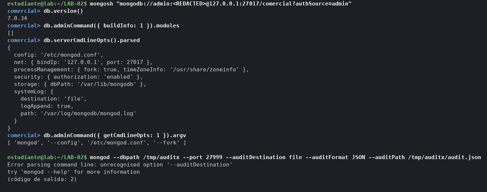

# Evidencia 01 — Lo que no existe en esta edición (Actividad 1)

**Estudiante:** `<Nombre completo>` · **Matrícula:** `<Matrícula>`  
**Materia:** Gestión de Seguridad y Desempeño de Bases de Datos · **Unidad III** · **LAB-02**  
**Servidor:** MongoDB 7.0.34 Community · `/etc/mongod.conf` · 127.0.0.1:27017 · base `comercial`  
**Ejecución:** 2026-11-07 UTC (2026-11-06 por la noche, hora de Culiacán, UTC−7)  
**Sesión del DBA:** `mongosh "mongodb://admin:<REDACTED>@127.0.0.1:27017/comercial?authSource=admin"`  
Las contraseñas visibles se sustituyeron por `<REDACTED>`.

## Preparación (sección 6.3)

Los usuarios se crearon con la excepción de localhost (mongosh sin credenciales en el propio servidor). La bitácora registró al arrancar `note: no users configured in admin.system.users, allowing localhost access`.

```text
test> use admin
switched to db admin
admin> db.createUser({ user: "admin", pwd: "<REDACTED>", roles: ["root"] })
{ ok: 1 }
admin> db.auth("admin", "<REDACTED>")
{ ok: 1 }
admin> use comercial
switched to db comercial
comercial> db.createUser({
...   user: "app_ventas",
...   pwd: "<REDACTED>",
...   roles: [{ role: "readWrite", db: "comercial" }]
... })
{ ok: 1 }
comercial> db.clientes.insertMany([
...   { _id: 1, nombre: "Ana López", correo: "ana.lopez@example.test", telefono: "6671234567", rfc: "LOAA850315ABC", edad: 41, ciudad: "Culiacán", codigo_postal: "80000" },
...   { _id: 2, nombre: "Carlos Pérez", correo: "carlos.perez@example.test", telefono: "6672345678", rfc: "PECA900720DEF", edad: 35, ciudad: "Culiacán", codigo_postal: "80100" },
...   { _id: 3, nombre: "María García", correo: "maria.garcia@example.test", telefono: "6673456789", rfc: "GAMA780912GHI", edad: 47, ciudad: "Mazatlán", codigo_postal: "82000" },
...   { _id: 4, nombre: "Luis Torres", correo: "luis.torres@example.test", telefono: "6674567890", rfc: "TOLU920201JKL", edad: 34, ciudad: "Los Mochis", codigo_postal: "81200" },
...   { _id: 5, nombre: "Laura Sánchez", correo: "laura.sanchez@example.test", telefono: "6675678901", rfc: "SALA880525MNO", edad: 38, ciudad: "Culiacán", codigo_postal: "80200" }
... ])
{
  acknowledged: true,
  insertedIds: { '0': 1, '1': 2, '2': 3, '3': 4, '4': 5 }
}
```

## Comandos y resultado

```text
comercial> function bitacora() {
...   return db.adminCommand({ getLog: "global" }).log.map(l => JSON.parse(l))
... }
[Function: bitacora]
comercial> db.version()
7.0.34
comercial> db.adminCommand({ buildInfo: 1 }).modules
[]
comercial> db.serverCmdLineOpts().parsed
{
  config: '/etc/mongod.conf',
  net: { bindIp: '127.0.0.1', port: 27017 },
  processManagement: { fork: true, timeZoneInfo: '/usr/share/zoneinfo' },
  security: { authorization: 'enabled' },
  storage: { dbPath: '/var/lib/mongodb' },
  systemLog: {
    destination: 'file',
    logAppend: true,
    path: '/var/log/mongodb/mongod.log'
  }
}
comercial> db.adminCommand({ getCmdLineOpts: 1 }).argv
[ 'mongod', '--config', '/etc/mongod.conf', '--fork' ]
```



## Prueba directa: la opción de auditoría no existe en este binario

Se intentó arrancar una instancia de prueba (otro puerto y otro directorio, sin afectar al servidor del laboratorio) con las opciones de auditoría nativa:

```text
$ mongod --dbpath /tmp/auditx --port 27999 --auditDestination file --auditFormat JSON --auditPath /tmp/auditx/audit.json
Error parsing command line: unrecognised option '--auditDestination'
try 'mongod --help' for more information
(código de salida: 2)
```

El binario Community no reconoce `--auditDestination`: la función no está deshabilitada, simplemente no existe en esta edición.

## Respuestas

**1. ¿Qué edición de MongoDB estás usando? ¿Qué evidencia lo demuestra?** MongoDB **7.0.34 Community**. La evidencia es `buildInfo.modules = []`: en Enterprise ese arreglo incluye `"enterprise"`. Lo confirma la prueba directa: al intentar arrancar `mongod` con `--auditDestination`, el binario responde `unrecognised option`. Y `serverCmdLineOpts().parsed` no tiene sección `auditLog`.

**2. ¿A dónde escribe tu servidor su bitácora? ¿Cómo lo sabes?** Al archivo `/var/log/mongodb/mongod.log`, en modo de agregar (`logAppend: true`). Lo muestra `db.serverCmdLineOpts().parsed.systemLog` (`destination: 'file'`, `path: '/var/log/mongodb/mongod.log'`), que refleja el archivo de configuración `/etc/mongod.conf` con el que arrancó el proceso (`argv: ['mongod', '--config', '/etc/mongod.conf', '--fork']`). Si no existiera `systemLog`, la bitácora iría a la salida estándar del proceso.

**3. Categorías de eventos de la auditoría nativa (REF-U3-04).**

1. Cambios de esquema (DDL).
2. Eventos de conjuntos de réplicas y de clústeres fragmentados.
3. Autenticación y autorización.
4. Operaciones CRUD (requiere `auditAuthorizationSuccess: true`).

**4. ¿Qué evaluar antes de licenciar Enterprise o migrar a Atlas solo para obtener auditoría?** Costo total (licencias o suscripción, nivel M10 o superior en Atlas) frente al riesgo que se quiere cubrir; obligaciones legales o contractuales que exijan auditoría (protección de datos personales, auditorías de clientes, normativa del sector); dónde quedarían los datos (en Atlas, en la nube del proveedor y en qué región) y si eso es aceptable; esfuerzo y riesgo de la migración (versiones, aplicaciones, ventanas de servicio, pruebas); el impacto de desempeño y almacenamiento de la propia auditoría; quién custodiará y revisará los eventos (sin un proceso de revisión, la licencia no aporta evidencia útil); y las alternativas, como controles compensatorios, auditoría en la capa de aplicación o mover los datos sensibles a un motor que ya audite (como PostgreSQL con pgaudit del LAB-01).
