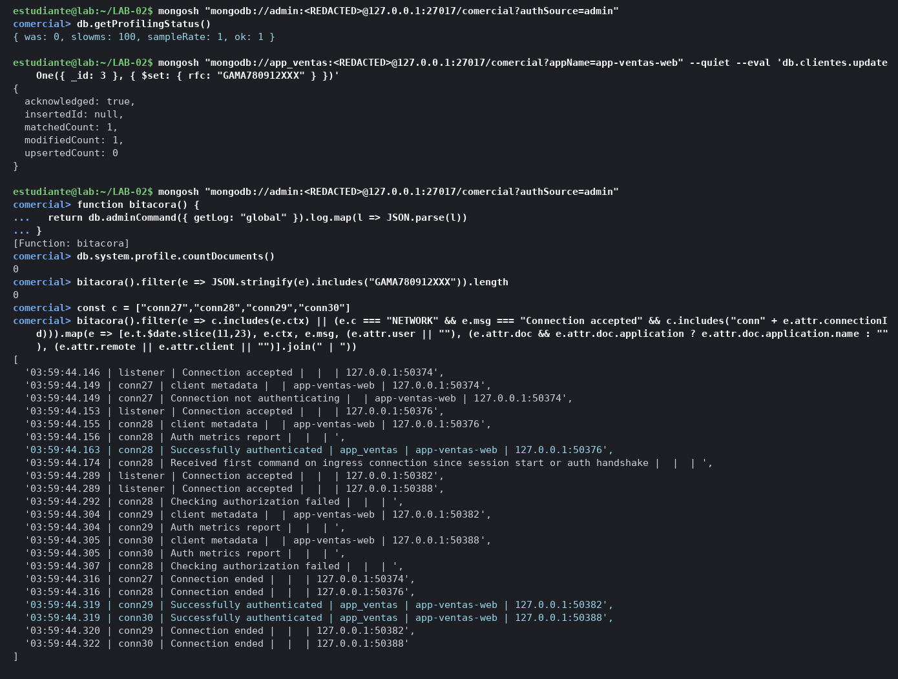

# Evidencia 02 — El incidente sin perfilado (Actividad 2)

**Estudiante:** `<Nombre completo>` · **Matrícula:** `<Matrícula>`  
**Materia:** Gestión de Seguridad y Desempeño de Bases de Datos · **Unidad III** · **LAB-02**  
**Servidor:** MongoDB 7.0.34 Community · `/etc/mongod.conf` · 127.0.0.1:27017 · base `comercial`  
**Ejecución:** 2026-11-07 UTC (2026-11-06 por la noche, hora de Culiacán, UTC−7)  
**Sesión del DBA:** `mongosh "mongodb://admin:<REDACTED>@127.0.0.1:27017/comercial?authSource=admin"`  
Las contraseñas visibles se sustituyeron por `<REDACTED>`.

## Estado del perfilador

```text
comercial> db.getProfilingStatus()
{ was: 0, slowms: 100, sampleRate: 1, ok: 1 }
```

## Cambio del RFC por la aplicación

```text
$ mongosh "mongodb://app_ventas:<REDACTED>@127.0.0.1:27017/comercial?appName=app-ventas-web" --quiet --eval 'db.clientes.updateOne({ _id: 3 }, { $set: { rfc: "GAMA780912XXX" } })'
{
  acknowledged: true,
  insertedId: null,
  matchedCount: 1,
  modifiedCount: 1,
  upsertedCount: 0
}
```

## Búsqueda de evidencia

```text
comercial> function bitacora() {
...   return db.adminCommand({ getLog: "global" }).log.map(l => JSON.parse(l))
... }
[Function: bitacora]
comercial> db.system.profile.countDocuments()
0
comercial> bitacora().filter(e => JSON.stringify(e).includes("GAMA780912XXX")).length
0
comercial> bitacora().filter(e => JSON.stringify(e).includes("app-ventas-web")).map(e => ({ t: e.t, c: e.c, ctx: e.ctx, msg: e.msg }))
[
  {
    t: { '$date': '2026-11-07T03:59:44.149+00:00' },
    c: 'NETWORK',
    ctx: 'conn27',
    msg: 'client metadata'
  },
  {
    t: { '$date': '2026-11-07T03:59:44.149+00:00' },
    c: 'ACCESS',
    ctx: 'conn27',
    msg: 'Connection not authenticating'
  },
  {
    t: { '$date': '2026-11-07T03:59:44.155+00:00' },
    c: 'NETWORK',
    ctx: 'conn28',
    msg: 'client metadata'
  },
  {
    t: { '$date': '2026-11-07T03:59:44.163+00:00' },
    c: 'ACCESS',
    ctx: 'conn28',
    msg: 'Successfully authenticated'
  },
  {
    t: { '$date': '2026-11-07T03:59:44.304+00:00' },
    c: 'NETWORK',
    ctx: 'conn29',
    msg: 'client metadata'
  },
  {
    t: { '$date': '2026-11-07T03:59:44.305+00:00' },
    c: 'NETWORK',
    ctx: 'conn30',
    msg: 'client metadata'
  },
  {
    t: { '$date': '2026-11-07T03:59:44.319+00:00' },
    c: 'ACCESS',
    ctx: 'conn29',
    msg: 'Successfully authenticated'
  },
  {
    t: { '$date': '2026-11-07T03:59:44.319+00:00' },
    c: 'ACCESS',
    ctx: 'conn30',
    msg: 'Successfully authenticated'
  }
]
```

Vista compacta de las mismas conexiones, una línea por evento (hora · contexto · mensaje · usuario · aplicación · origen):

```text
comercial> const c = ["conn27","conn28","conn29","conn30"]
comercial> bitacora().filter(e => c.includes(e.ctx) || (e.c === "NETWORK" && e.msg === "Connection accepted" && c.includes("conn" + e.attr.connectionId))).map(e => [e.t.$date.slice(11,23), e.ctx, e.msg, (e.attr.user || ""), (e.attr.doc && e.attr.doc.application ? e.attr.doc.application.name : ""), (e.attr.remote || e.attr.client || "")].join(" | "))
[
  '03:59:44.146 | listener | Connection accepted |  |  | 127.0.0.1:50374',
  '03:59:44.149 | conn27 | client metadata |  | app-ventas-web | 127.0.0.1:50374',
  '03:59:44.149 | conn27 | Connection not authenticating |  | app-ventas-web | 127.0.0.1:50374',
  '03:59:44.153 | listener | Connection accepted |  |  | 127.0.0.1:50376',
  '03:59:44.155 | conn28 | client metadata |  | app-ventas-web | 127.0.0.1:50376',
  '03:59:44.156 | conn28 | Auth metrics report |  |  | ',
  '03:59:44.163 | conn28 | Successfully authenticated | app_ventas | app-ventas-web | 127.0.0.1:50376',
  '03:59:44.174 | conn28 | Received first command on ingress connection since session start or auth handshake |  |  | ',
  '03:59:44.289 | listener | Connection accepted |  |  | 127.0.0.1:50382',
  '03:59:44.289 | listener | Connection accepted |  |  | 127.0.0.1:50388',
  '03:59:44.292 | conn28 | Checking authorization failed |  |  | ',
  '03:59:44.304 | conn29 | client metadata |  | app-ventas-web | 127.0.0.1:50382',
  '03:59:44.304 | conn29 | Auth metrics report |  |  | ',
  '03:59:44.305 | conn30 | client metadata |  | app-ventas-web | 127.0.0.1:50388',
  '03:59:44.305 | conn30 | Auth metrics report |  |  | ',
  '03:59:44.307 | conn28 | Checking authorization failed |  |  | ',
  '03:59:44.316 | conn27 | Connection ended |  |  | 127.0.0.1:50374',
  '03:59:44.316 | conn28 | Connection ended |  |  | 127.0.0.1:50376',
  '03:59:44.319 | conn29 | Successfully authenticated | app_ventas | app-ventas-web | 127.0.0.1:50382',
  '03:59:44.319 | conn30 | Successfully authenticated | app_ventas | app-ventas-web | 127.0.0.1:50388',
  '03:59:44.320 | conn29 | Connection ended |  |  | 127.0.0.1:50382',
  '03:59:44.322 | conn30 | Connection ended |  |  | 127.0.0.1:50388'
]
```



## Respuestas

**1. ¿Puedes demostrar qué cambió? ¿Y quién se conectó a esa hora?** **Qué cambió: no hay evidencia con esta configuración.** El perfilador estaba en nivel 0 (`system.profile` vacío) y la bitácora no contiene el valor `GAMA780912XXX` ni ninguna línea del `updateOne`; solo puede verse el estado final del documento. **Quién se conectó: sí.** La bitácora muestra que a las 03:59:44 UTC (20:59 del 6-nov en Culiacán) se autenticó `app_ventas` con SCRAM-SHA-256, desde 127.0.0.1, declarando la aplicación `app-ventas-web`, en tres conexiones (conn28, conn29 y conn30). Pero que una cuenta se conectara no prueba qué hizo: la conexión es un indicio, no evidencia del cambio.

**2. ¿Por qué mongosh abre varias conexiones para una sola instrucción? ¿Cuál se autentica?** Porque el controlador de MongoDB separa funciones:

| Conexión | Función | ¿Se autentica? |
|---|---|---|
| conn27 | Monitoreo del servidor (*heartbeat*, detección de topología). No ejecuta operaciones | No: `Connection not authenticating` |
| conn28 | Primera conexión del *pool*: mongosh la usa para sus comprobaciones de arranque. Dos de ellas (`atlascli` y `getParameter` en `admin`) fueron rechazadas: `Checking authorization failed` | Sí, `app_ventas` |
| conn29, conn30 | Conexiones adicionales del *pool* que el controlador abre para ejecutar las operaciones | Sí, `app_ventas` |

En las conexiones del *pool* se autentica `app_ventas`; la de monitoreo no se autentica. La bitácora no dice en cuál de ellas se ejecutó el `updateOne`: registra autenticaciones, no operaciones. En la guía de referencia aparecieron dos conexiones (conn8 y conn9); aquí aparecieron cuatro porque mongosh 2.14.1 hace más comprobaciones al arrancar. Por eso hay que contar sesiones y no conexiones.
