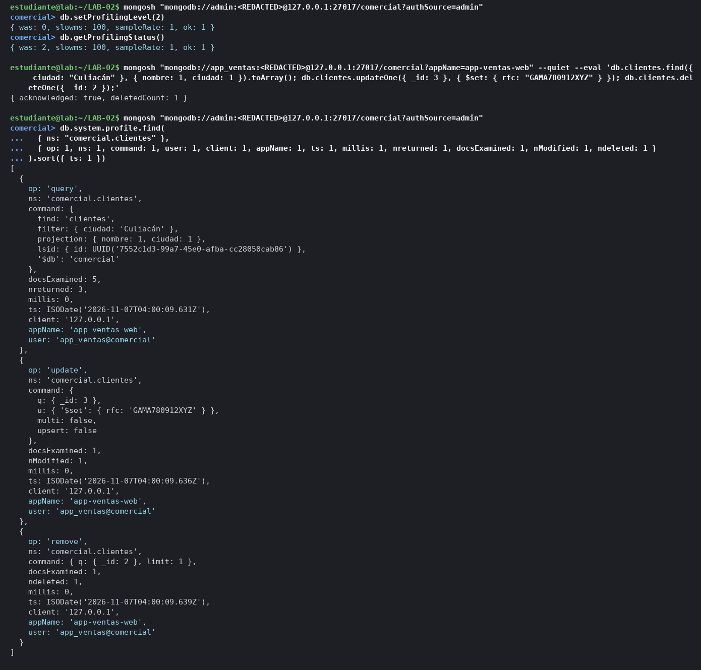

# Evidencia 03 — Activar el perfilador y registrar operaciones (Actividad 3)

**Estudiante:** `<Nombre completo>` · **Matrícula:** `<Matrícula>`  
**Materia:** Gestión de Seguridad y Desempeño de Bases de Datos · **Unidad III** · **LAB-02**  
**Servidor:** MongoDB 7.0.34 Community · `/etc/mongod.conf` · 127.0.0.1:27017 · base `comercial`  
**Ejecución:** 2026-11-07 UTC (2026-11-06 por la noche, hora de Culiacán, UTC−7)  
**Sesión del DBA:** `mongosh "mongodb://admin:<REDACTED>@127.0.0.1:27017/comercial?authSource=admin"`  
Las contraseñas visibles se sustituyeron por `<REDACTED>`.

## Nivel 2 en la base `comercial`

```text
comercial> db.setProfilingLevel(2)
{ was: 0, slowms: 100, sampleRate: 1, ok: 1 }
comercial> db.getProfilingStatus()
{ was: 2, slowms: 100, sampleRate: 1, ok: 1 }
```

`setProfilingLevel` devuelve en `was` el nivel **anterior** (0); por eso `getProfilingStatus()` se consulta después para ver el vigente (2).

## Operaciones de la aplicación

```text
$ mongosh "mongodb://app_ventas:<REDACTED>@127.0.0.1:27017/comercial?appName=app-ventas-web" --quiet --eval 'db.clientes.find({ ciudad: "Culiacán" }, { nombre: 1, ciudad: 1 }).toArray(); db.clientes.updateOne({ _id: 3 }, { $set: { rfc: "GAMA780912XYZ" } }); db.clientes.deleteOne({ _id: 2 });'
{ acknowledged: true, deletedCount: 1 }
```

(`--eval` solo imprime el resultado de la última expresión, el `deleteOne`.)

## Consulta del perfilador

```text
comercial> db.system.profile.find(
...   { ns: "comercial.clientes" },
...   { op: 1, ns: 1, command: 1, user: 1, client: 1, appName: 1, ts: 1, millis: 1, nreturned: 1, docsExamined: 1, nModified: 1, ndeleted: 1 }
... ).sort({ ts: 1 })
[
  {
    op: 'query',
    ns: 'comercial.clientes',
    command: {
      find: 'clientes',
      filter: { ciudad: 'Culiacán' },
      projection: { nombre: 1, ciudad: 1 },
      lsid: { id: UUID('7552c1d3-99a7-45e0-afba-cc28050cab86') },
      '$db': 'comercial'
    },
    docsExamined: 5,
    nreturned: 3,
    millis: 0,
    ts: ISODate('2026-11-07T04:00:09.631Z'),
    client: '127.0.0.1',
    appName: 'app-ventas-web',
    user: 'app_ventas@comercial'
  },
  {
    op: 'update',
    ns: 'comercial.clientes',
    command: {
      q: { _id: 3 },
      u: { '$set': { rfc: 'GAMA780912XYZ' } },
      multi: false,
      upsert: false
    },
    docsExamined: 1,
    nModified: 1,
    millis: 0,
    ts: ISODate('2026-11-07T04:00:09.636Z'),
    client: '127.0.0.1',
    appName: 'app-ventas-web',
    user: 'app_ventas@comercial'
  },
  {
    op: 'remove',
    ns: 'comercial.clientes',
    command: { q: { _id: 2 }, limit: 1 },
    docsExamined: 1,
    ndeleted: 1,
    millis: 0,
    ts: ISODate('2026-11-07T04:00:09.639Z'),
    client: '127.0.0.1',
    appName: 'app-ventas-web',
    user: 'app_ventas@comercial'
  }
]
```



Antes de borrar `system.profile` en la Actividad 4 se exportó su contenido a `evidencias/system-profile-actividad3.json` (incluido en `hashes.sha256`). Contiene estas tres operaciones y la consulta del DBA al propio perfilador.

## 9.1 Interpretación de los documentos

Horas en UTC del 2026-11-07 (hora de Culiacán: 21:00:09 del 6-nov).

| # | op | Usuario | Cliente | Aplicación | Momento | Qué hizo | Documentos afectados |
|---|---|---|---|---|---|---|---|
| 1 | query | app_ventas@comercial | 127.0.0.1 | app-ventas-web | 04:00:09.631 | `find` en `clientes` con filtro `ciudad: "Culiacán"`, proyectando `nombre` y `ciudad` | Examinó 5, devolvió 3 (`nreturned: 3`) |
| 2 | update | app_ventas@comercial | 127.0.0.1 | app-ventas-web | 04:00:09.636 | `updateOne` sobre `_id: 3` con `$set: { rfc: "GAMA780912XYZ" }` | 1 modificado (`nModified: 1`) |
| 3 | remove | app_ventas@comercial | 127.0.0.1 | app-ventas-web | 04:00:09.639 | `deleteOne` sobre `_id: 2` (`limit: 1`) | 1 eliminado (`ndeleted: 1`) |

Las tres operaciones duraron menos de 1 ms (`millis: 0`) y se ejecutaron en 8 ms, en una sola sesión del cliente (`lsid`).

## Respuestas

**1. ¿Puedes saber cuál era el RFC antes del cambio con `system.profile`?** No. El perfilador guarda el comando (`q` y `u`: qué documento y qué `$set`), no el documento antes ni después. El valor anterior (`GAMA780912XXX`, de la Actividad 2) no aparece en ninguna parte del perfilador ni de la bitácora.

**2. ¿Puedes saber qué datos tenía el documento eliminado?** No. Solo se sabe que se eliminó el documento con `_id: 2`. Su nombre, correo y RFC (Carlos Pérez) no quedaron registrados; solo se conocen por el script de carga, que no es evidencia del servidor. Es la misma diferencia que en el LAB-01 entre auditoría de sentencia y de dato, pero aquí no hay disparador que la compense (MongoDB Community no tiene disparadores en el servidor; los *change streams* requieren un conjunto de réplicas y un proceso que los consuma).

**3. El nivel 2 registró la consulta. Ventaja y riesgo.** Ventaja: sí queda evidencia de las lecturas, con usuario, cliente, aplicación, momento, filtro y número de documentos devueltos; permite responder “¿quién consultó a los clientes de Culiacán?” o detectar una extracción masiva por `nreturned` alto. Riesgo: el filtro de cada consulta se guarda tal cual. Si la aplicación busca `{ rfc: "GAMA780912XYZ" }` o `{ correo: "..." }`, el dato personal queda copiado en `system.profile`, que cualquiera con `dbAdmin` puede leer. Además, cada lectura genera una escritura (costo de desempeño) y la colección de 1 MB se llena más rápido, con lo que la evidencia de las modificaciones se sobrescribe antes.

**4. ¿Por qué `user` incluye `@comercial`?** Porque en MongoDB un usuario se identifica por su nombre **y** la base donde fue creado (su base de autenticación). `app_ventas@comercial` y un hipotético `app_ventas@admin` serían usuarios distintos, con contraseñas y roles diferentes. Por la misma razón, el administrador aparece como `admin@admin`.
