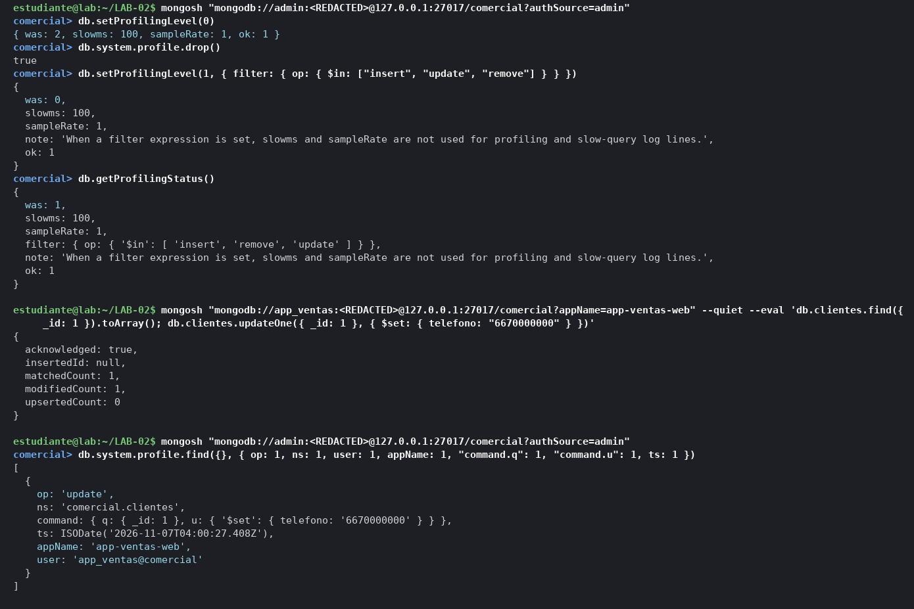

# Evidencia 04 — Reducir el volumen con un filtro (Actividad 4)

**Estudiante:** `<Nombre completo>` · **Matrícula:** `<Matrícula>`  
**Materia:** Gestión de Seguridad y Desempeño de Bases de Datos · **Unidad III** · **LAB-02**  
**Servidor:** MongoDB 7.0.34 Community · `/etc/mongod.conf` · 127.0.0.1:27017 · base `comercial`  
**Ejecución:** 2026-11-07 UTC (2026-11-06 por la noche, hora de Culiacán, UTC−7)  
**Sesión del DBA:** `mongosh "mongodb://admin:<REDACTED>@127.0.0.1:27017/comercial?authSource=admin"`  
Las contraseñas visibles se sustituyeron por `<REDACTED>`.

Antes de borrar `system.profile`, su contenido se exportó a `evidencias/system-profile-actividad3.json`.

## Aplicar el filtro

```text
comercial> db.setProfilingLevel(0)
{ was: 2, slowms: 100, sampleRate: 1, ok: 1 }
comercial> db.system.profile.drop()
true
comercial> db.setProfilingLevel(1, { filter: { op: { $in: ["insert", "update", "remove"] } } })
{
  was: 0,
  slowms: 100,
  sampleRate: 1,
  note: 'When a filter expression is set, slowms and sampleRate are not used for profiling and slow-query log lines.',
  ok: 1
}
comercial> db.getProfilingStatus()
{
  was: 1,
  slowms: 100,
  sampleRate: 1,
  filter: { op: { '$in': [ 'insert', 'remove', 'update' ] } },
  note: 'When a filter expression is set, slowms and sampleRate are not used for profiling and slow-query log lines.',
  ok: 1
}
```

## Operaciones de la aplicación (una lectura y una actualización)

```text
$ mongosh "mongodb://app_ventas:<REDACTED>@127.0.0.1:27017/comercial?appName=app-ventas-web" --quiet --eval 'db.clientes.find({ _id: 1 }).toArray(); db.clientes.updateOne({ _id: 1 }, { $set: { telefono: "6670000000" } })'
{
  acknowledged: true,
  insertedId: null,
  matchedCount: 1,
  modifiedCount: 1,
  upsertedCount: 0
}
```

## Contenido del perfilador

```text
comercial> db.system.profile.find({}, { op: 1, ns: 1, user: 1, appName: 1, "command.q": 1, "command.u": 1, ts: 1 })
[
  {
    op: 'update',
    ns: 'comercial.clientes',
    command: { q: { _id: 1 }, u: { '$set': { telefono: '6670000000' } } },
    ts: ISODate('2026-11-07T04:00:27.408Z'),
    appName: 'app-ventas-web',
    user: 'app_ventas@comercial'
  }
]
```



Solo quedó registrada la operación `update`; la lectura `find({ _id: 1 })` no aparece. Las operaciones del DBA (como la consulta al propio perfilador) tampoco, porque son `query` o `command`.

## Respuestas

**1. ¿Qué perdiste de evidencia? ¿Qué ganaste?** **Perdí** el registro de todas las lecturas (`query`, `getmore`) y de los comandos (`command`: agregaciones, conteos, `distinct`, comandos administrativos). Ya no puedo demostrar quién consultó datos sensibles ni detectar una extracción masiva. **Gané** mucho menos volumen: en un sistema real las lecturas suelen ser la gran mayoría de las operaciones. Eso significa menos impacto en el desempeño y, sobre todo, que la colección limitada de 1 MB tarda mucho más en sobrescribir la evidencia de las modificaciones, que es lo que pidió Dirección. También dejan de copiarse al perfilador los filtros de búsqueda con datos personales. Además, con un filtro activo `slowms` y `sampleRate` dejan de aplicarse: el filtro decide todo.

**2. Filtro para operaciones solo sobre la colección `clientes`:**

```javascript
db.setProfilingLevel(1, { filter: { ns: "comercial.clientes", op: { $in: ["insert", "update", "remove"] } } })
```

Si también interesaran las lecturas de esa colección: `{ filter: { ns: "comercial.clientes" } }`. Y para auditar solo cambios del campo RFC no hay un filtro confiable: el perfilador no indica qué campos cambió una actualización con *pipeline* o un reemplazo completo.
