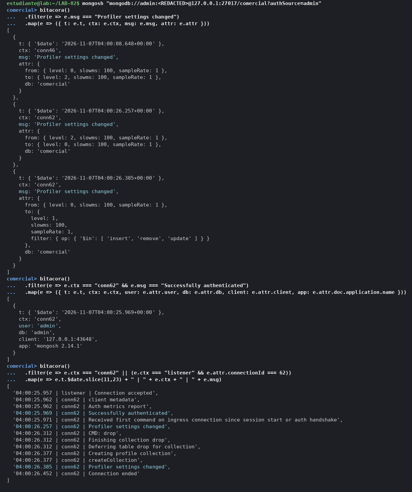

# Evidencia 06 — Correlacionar un cambio de configuración con su autor (Actividad 6)

**Estudiante:** `<Nombre completo>` · **Matrícula:** `<Matrícula>`  
**Materia:** Gestión de Seguridad y Desempeño de Bases de Datos · **Unidad III** · **LAB-02**  
**Servidor:** MongoDB 7.0.34 Community · `/etc/mongod.conf` · 127.0.0.1:27017 · base `comercial`  
**Ejecución:** 2026-11-07 UTC (2026-11-06 por la noche, hora de Culiacán, UTC−7)  
**Sesión del DBA:** `mongosh "mongodb://admin:<REDACTED>@127.0.0.1:27017/comercial?authSource=admin"`  
Las contraseñas visibles se sustituyeron por `<REDACTED>`.

## Cambios del perfilador registrados

```text
comercial> function bitacora() {
...   return db.adminCommand({ getLog: "global" }).log.map(l => JSON.parse(l))
... }
[Function: bitacora]
comercial> bitacora()
...   .filter(e => e.msg === "Profiler settings changed")
...   .map(e => ({ t: e.t, ctx: e.ctx, msg: e.msg, attr: e.attr }))
[
  {
    t: { '$date': '2026-11-07T04:00:08.648+00:00' },
    ctx: 'conn46',
    msg: 'Profiler settings changed',
    attr: {
      from: { level: 0, slowms: 100, sampleRate: 1 },
      to: { level: 2, slowms: 100, sampleRate: 1 },
      db: 'comercial'
    }
  },
  {
    t: { '$date': '2026-11-07T04:00:26.257+00:00' },
    ctx: 'conn62',
    msg: 'Profiler settings changed',
    attr: {
      from: { level: 2, slowms: 100, sampleRate: 1 },
      to: { level: 0, slowms: 100, sampleRate: 1 },
      db: 'comercial'
    }
  },
  {
    t: { '$date': '2026-11-07T04:00:26.385+00:00' },
    ctx: 'conn62',
    msg: 'Profiler settings changed',
    attr: {
      from: { level: 0, slowms: 100, sampleRate: 1 },
      to: {
        level: 1,
        slowms: 100,
        sampleRate: 1,
        filter: { op: { '$in': [ 'insert', 'remove', 'update' ] } }
      },
      db: 'comercial'
    }
  }
]
```

## Autenticación y actividad de la conexión `conn62`

```text
comercial> function bitacora() {
...   return db.adminCommand({ getLog: "global" }).log.map(l => JSON.parse(l))
... }
[Function: bitacora]
comercial> bitacora()
...   .filter(e => e.ctx === "conn62" && e.msg === "Successfully authenticated")
...   .map(e => ({ t: e.t, ctx: e.ctx, user: e.attr.user, db: e.attr.db, client: e.attr.client, app: e.attr.doc.application.name }))
[
  {
    t: { '$date': '2026-11-07T04:00:25.969+00:00' },
    ctx: 'conn62',
    user: 'admin',
    db: 'admin',
    client: '127.0.0.1:43648',
    app: 'mongosh 2.14.1'
  }
]
comercial> bitacora()
...   .filter(e => e.ctx === "conn62" || (e.ctx === "listener" && e.attr.connectionId === 62))
...   .map(e => e.t.$date.slice(11,23) + " | " + e.ctx + " | " + e.msg)
[
  '04:00:25.957 | listener | Connection accepted',
  '04:00:25.962 | conn62 | client metadata',
  '04:00:25.962 | conn62 | Auth metrics report',
  '04:00:25.969 | conn62 | Successfully authenticated',
  '04:00:25.971 | conn62 | Received first command on ingress connection since session start or auth handshake',
  '04:00:26.257 | conn62 | Profiler settings changed',
  '04:00:26.312 | conn62 | CMD: drop',
  '04:00:26.312 | conn62 | Finishing collection drop',
  '04:00:26.312 | conn62 | Deferring table drop for collection',
  '04:00:26.377 | conn62 | Creating profile collection',
  '04:00:26.377 | conn62 | createCollection',
  '04:00:26.385 | conn62 | Profiler settings changed',
  '04:00:26.452 | conn62 | Connection ended'
]
```



La línea `Profiler settings changed` no incluye el usuario, pero sí el contexto `conn62`. En esa misma conexión, 288 ms antes, se autenticó `admin` (base `admin`), desde 127.0.0.1:43648, con mongosh 2.14.1. La secuencia completa de `conn62` coincide con lo ejecutado en la Actividad 4: nivel 2 → 0, `drop` de `comercial.system.profile`, recreación de la colección y nivel 0 → 1 con filtro.

## Reutilización de números de conexión entre reinicios

```text
$ # Extracto de evidencias/mongod.log: arranques del servidor y uso de conn2
L40   03:58:39.876  ---- arranque del servidor ----
L52   03:58:46.423  conn2  Connection not authenticating   user=-  app=mongosh 2.14.1
L754  04:01:36.771  ---- arranque del servidor ----
L761  04:01:40.403  conn2  Successfully authenticated      user=admin  app=mongosh 2.14.1
L887  04:01:49.478  ---- arranque del servidor ----
L894  04:01:53.330  conn2  Successfully authenticated      user=admin  app=mongosh 2.14.1
```

`conn2` aparece en **tres vidas distintas** del servidor: la primera vez fue una conexión de monitoreo sin autenticar (03:58:46), y después de cada reinicio (Actividad 8) fue una sesión de `admin`. El número de conexión solo identifica una conexión **dentro de un mismo arranque**.

## Respuestas

**1. ¿Qué usuario cambió la configuración del perfilador? ¿Qué dos eventos lo demuestran?** `admin@admin`. Lo demuestran dos líneas con el mismo `ctx: conn62`: `Successfully authenticated` (04:00:25.969, `user: admin`, `db: admin`, `client: 127.0.0.1:43648`; `mongod.log` L388) y `Profiler settings changed` (04:00:26.257 y 04:00:26.385, con `from`/`to` y `db: comercial`; `mongod.log` L390 y L396). El primer cambio de la Actividad 3 (nivel 0 → 2, conn46) se correlaciona de la misma forma.

**2. ¿Qué condición debe cumplirse para que la correlación sea válida?** Que ambos eventos pertenezcan al **mismo arranque del servidor**. Los números de conexión vuelven a empezar en cada inicio de `mongod`, como muestra `conn2` arriba. Por eso hay que comprobar que no existe una línea de arranque (`mongod startup complete`) entre la autenticación y el cambio. Y como `getLog` se vacía al reiniciar, solo el archivo `mongod.log`, que conserva varios arranques, permite verificarlo. Además, ambos eventos deben estar presentes: si la autenticación cayó fuera de los últimos 1024 eventos de `getLog` o rotó fuera del archivo, la correlación no puede hacerse. Una conexión autentica a un usuario durante toda su vida, así que no hay ambigüedad dentro de ella (salvo un `db.auth()` posterior con otro usuario, que también quedaría registrado en el mismo `ctx`).

**3. ¿Por qué es relevante que quede registrado un cambio del propio mecanismo de registro?** Porque es exactamente lo que haría alguien que quiere actuar sin dejar rastro: apagar el perfilador, actuar y volver a encenderlo, o borrar `system.profile`. Si esos cambios no quedaran registrados, un hueco en el perfilador sería indistinguible de “no pasó nada”. La línea `Profiler settings changed`, y aquí también `CMD: drop` sobre `comercial.system.profile`, convierte el hueco en un hecho fechado y atribuible. Es el mismo papel que tuvo `parameter ... changed to` y `DISABLE TRIGGER` en el LAB-01.
