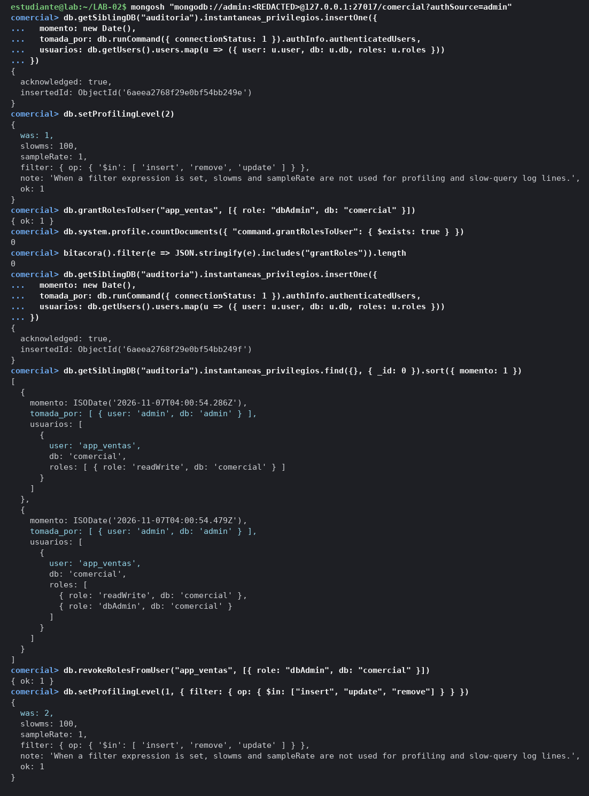

# Evidencia 07 — Cambios de privilegios: el límite más importante (Actividad 7)

**Estudiante:** `<Nombre completo>` · **Matrícula:** `<Matrícula>`  
**Materia:** Gestión de Seguridad y Desempeño de Bases de Datos · **Unidad III** · **LAB-02**  
**Servidor:** MongoDB 7.0.34 Community · `/etc/mongod.conf` · 127.0.0.1:27017 · base `comercial`  
**Ejecución:** 2026-11-07 UTC (2026-11-06 por la noche, hora de Culiacán, UTC−7)  
**Sesión del DBA:** `mongosh "mongodb://admin:<REDACTED>@127.0.0.1:27017/comercial?authSource=admin"`  
Las contraseñas visibles se sustituyeron por `<REDACTED>`.

## Instantánea, cambio de privilegios, búsqueda de evidencia y segunda instantánea

```text
comercial> function bitacora() {
...   return db.adminCommand({ getLog: "global" }).log.map(l => JSON.parse(l))
... }
[Function: bitacora]
comercial> db.getSiblingDB("auditoria").instantaneas_privilegios.insertOne({
...   momento: new Date(),
...   tomada_por: db.runCommand({ connectionStatus: 1 }).authInfo.authenticatedUsers,
...   usuarios: db.getUsers().users.map(u => ({ user: u.user, db: u.db, roles: u.roles }))
... })
{
  acknowledged: true,
  insertedId: ObjectId('6aeea2768f29e0bf54bb249e')
}
comercial> db.setProfilingLevel(2)
{
  was: 1,
  slowms: 100,
  sampleRate: 1,
  filter: { op: { '$in': [ 'insert', 'remove', 'update' ] } },
  note: 'When a filter expression is set, slowms and sampleRate are not used for profiling and slow-query log lines.',
  ok: 1
}
comercial> db.grantRolesToUser("app_ventas", [{ role: "dbAdmin", db: "comercial" }])
{ ok: 1 }
comercial> db.system.profile.countDocuments({ "command.grantRolesToUser": { $exists: true } })
0
comercial> bitacora().filter(e => JSON.stringify(e).includes("grantRoles")).length
0
comercial> db.getSiblingDB("auditoria").instantaneas_privilegios.insertOne({
...   momento: new Date(),
...   tomada_por: db.runCommand({ connectionStatus: 1 }).authInfo.authenticatedUsers,
...   usuarios: db.getUsers().users.map(u => ({ user: u.user, db: u.db, roles: u.roles }))
... })
{
  acknowledged: true,
  insertedId: ObjectId('6aeea2768f29e0bf54bb249f')
}
comercial> db.getSiblingDB("auditoria").instantaneas_privilegios.find({}, { _id: 0 }).sort({ momento: 1 })
[
  {
    momento: ISODate('2026-11-07T04:00:54.286Z'),
    tomada_por: [ { user: 'admin', db: 'admin' } ],
    usuarios: [
      {
        user: 'app_ventas',
        db: 'comercial',
        roles: [ { role: 'readWrite', db: 'comercial' } ]
      }
    ]
  },
  {
    momento: ISODate('2026-11-07T04:00:54.479Z'),
    tomada_por: [ { user: 'admin', db: 'admin' } ],
    usuarios: [
      {
        user: 'app_ventas',
        db: 'comercial',
        roles: [
          { role: 'readWrite', db: 'comercial' },
          { role: 'dbAdmin', db: 'comercial' }
        ]
      }
    ]
  }
]
comercial> db.revokeRolesFromUser("app_ventas", [{ role: "dbAdmin", db: "comercial" }])
{ ok: 1 }
comercial> db.setProfilingLevel(1, { filter: { op: { $in: ["insert", "update", "remove"] } } })
{
  was: 2,
  slowms: 100,
  sampleRate: 1,
  filter: { op: { '$in': [ 'insert', 'remove', 'update' ] } },
  note: 'When a filter expression is set, slowms and sampleRate are not used for profiling and slow-query log lines.',
  ok: 1
}
```



Con el perfilador en **nivel 2**, `grantRolesToUser` no dejó ningún documento en `system.profile` (0) ni ninguna línea en la bitácora (0). Durante el nivel 2 sí se perfiló, en cambio, la consulta del DBA a `system.profile`: el perfilador funcionaba, pero los comandos de administración de usuarios no se registran.

## Comparación automática de instantáneas

```text
comercial> const s = db.getSiblingDB("auditoria").instantaneas_privilegios.find().sort({ momento: -1 }).limit(2).toArray().reverse()
comercial> const roles = snap => Object.fromEntries(snap.usuarios.map(u => [u.user + "@" + u.db, u.roles.map(r => r.role + "@" + r.db)]))
comercial> const [a, b] = [roles(s[0]), roles(s[1])]
comercial> Object.keys({ ...a, ...b }).map(k => ({ usuario: k, agregados: (b[k] || []).filter(r => !(a[k] || []).includes(r)), retirados: (a[k] || []).filter(r => !(b[k] || []).includes(r)) })).filter(x => x.agregados.length || x.retirados.length)
[
  {
    usuario: 'app_ventas@comercial',
    agregados: [ 'dbAdmin@comercial' ],
    retirados: []
  }
]
```

| Pregunta | ¿La instantánea responde? |
|---|---|
| ¿Cambiaron los privilegios de `app_ventas`? | Sí |
| ¿Qué rol se agregó? | Sí: `dbAdmin@comercial` |
| ¿Quién lo agregó? | No |
| ¿Cuándo exactamente? | No; solo que ocurrió entre 04:00:54.286 y 04:00:54.479 UTC |

**Indicio (no evidencia).** La bitácora muestra que en esa ventana había una única sesión activa, autenticada como `admin` en conn88–conn90 (L543–L552), y que conn90 cambió el perfilador a las 04:00:54.341 y 04:00:54.564 (L557–L558). Esto *sugiere* que fue `admin`, pero no lo prueba: no hay ningún registro de la operación de privilegio, y en un servidor con más sesiones simultáneas ni siquiera ese indicio existiría.

El rol se revocó al terminar y se restableció el filtro de la Actividad 4.

## Respuestas

**1. ¿Por qué un cambio de privilegios es uno de los eventos auditables más importantes?** Porque cambia lo que todo lo demás puede hacer. Un `GRANT` permite después cualquier abuso aparentemente “legítimo”, y es el paso típico de una escalada de privilegios. Aquí, `dbAdmin` le da a la aplicación la capacidad de cambiar el perfilador y de borrar `system.profile`: es decir, de borrar la evidencia de sus propias acciones. Si no se sabe quién otorgó un privilegio, no puede atribuirse nada de lo que ocurrió con él.

**2. ¿Con qué frecuencia tomarías instantáneas? ¿Qué factores influyen?** Para este servidor, cada **15 minutos** de forma automática, más una inmediatamente antes y después de cada cambio planificado. Factores: el riesgo y la sensibilidad de los datos; el tiempo máximo aceptable sin detectar un cambio (la frecuencia define la ventana en la que no se sabe *cuándo* ocurrió); el costo, que es bajo (un `getUsers()` y un documento pequeño); la cantidad de usuarios y roles; y la frecuencia legítima de cambios. Hay un límite que la frecuencia no resuelve: un privilegio otorgado y retirado entre dos instantáneas es invisible. También conviene incluir `getRoles({ showPrivileges: true })`, porque modificar un rol personalizado cambia privilegios sin tocar a los usuarios.

**3. ¿Quién debería poder escribir en `auditoria.instantaneas_privilegios`?** Solo una cuenta técnica dedicada al proceso automático (un rol con `insert` en esa colección y nada más), sin `update` ni `remove`, y con lectura para el área de auditoría. No el DBA con su cuenta habitual, ni las aplicaciones. Mejor aún, las instantáneas deberían enviarse fuera de este servidor: un `root` puede modificar o borrar cualquier colección local, incluida esta.

**4. Cómo comunicarlo a Dirección (tres líneas):**

> MongoDB Community no registra quién cambia los privilegios de una cuenta; ni el perfilador ni la bitácora lo hacen.
> Con instantáneas periódicas podemos **detectar** que un privilegio cambió y cuál, pero no **atribuirlo** a una persona ni fecharlo con exactitud.
> Si se requiere atribución, las opciones son MongoDB Enterprise/Atlas con auditoría nativa, o un procedimiento que registre cada cambio fuera de la base de datos.
