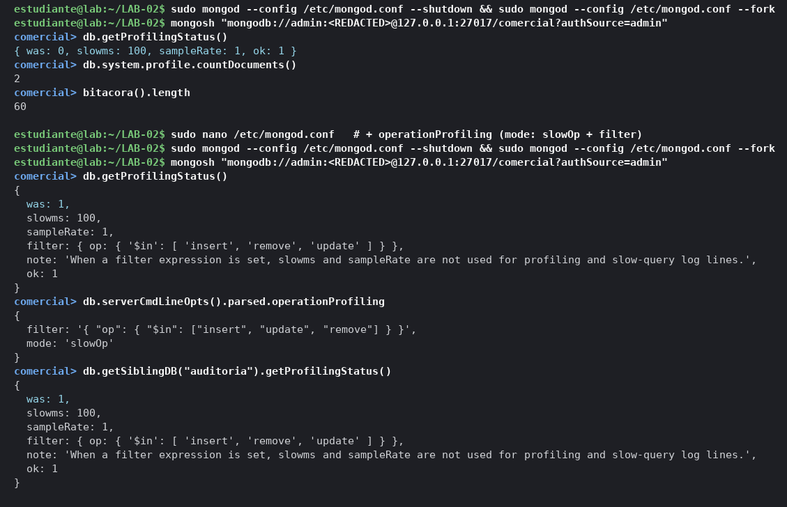

# Evidencia 08 — Conservación: exportar antes de perder (Actividad 8)

**Estudiante:** `<Nombre completo>` · **Matrícula:** `<Matrícula>`  
**Materia:** Gestión de Seguridad y Desempeño de Bases de Datos · **Unidad III** · **LAB-02**  
**Servidor:** MongoDB 7.0.34 Community · `/etc/mongod.conf` · 127.0.0.1:27017 · base `comercial`  
**Ejecución:** 2026-11-07 UTC (2026-11-06 por la noche, hora de Culiacán, UTC−7)  
**Sesión del DBA:** `mongosh "mongodb://admin:<REDACTED>@127.0.0.1:27017/comercial?authSource=admin"`  
Las contraseñas visibles se sustituyeron por `<REDACTED>`.

## Exportación (antes del reinicio)

```text
$ mongosh "mongodb://admin:<REDACTED>@127.0.0.1:27017/comercial?authSource=admin" --quiet --eval 'EJSON.stringify(db.system.profile.find({}, { op: 1, ns: 1, user: 1, client: 1, appName: 1, ts: 1, "command.q": 1, "command.u": 1 }).toArray(), null, 2)' > evidencias/system-profile.json
$ mongosh "mongodb://admin:<REDACTED>@127.0.0.1:27017/comercial?authSource=admin" --quiet --eval 'db.adminCommand({ getLog: "global" }).log.join("
")' > evidencias/bitacora-mongod.log
```

```text
$ cp /var/log/mongodb/mongod.log evidencias/mongod.log
$ cd evidencias && sha256sum bitacora-mongod.log mongod.log system-profile.json system-profile-actividad3.json > hashes.sha256
```

| Archivo | Contenido | SHA-256 |
|---|---|---|
| `system-profile.json` | Contenido de `system.profile` en el momento de exportar: el `update` de la Actividad 4 y la consulta del DBA en nivel 2 | `e6d39fe7…3049` |
| `system-profile-actividad3.json` | Exportación previa al `drop()` de la Actividad 4: `query`, `update` y `remove` de `app_ventas` | `bd10f52b…762b` |
| `bitacora-mongod.log` | `getLog`: los eventos en memoria del arranque vigente (600 eventos en ese momento) | `9fba4ce8…1b12` |
| `mongod.log` | Archivo de `systemLog.path`: historia completa, con los tres arranques | `e18783f5…c5a6` |

Los valores completos están en `hashes.sha256`. Se verificó que ninguno de los archivos contiene contraseñas. `bitacora-mongod.log` alterna cada evento con una línea vacía; se conservó tal como lo produjo el comando de la guía, para no alterar el archivo cuyo hash se registra.

El `system-profile.json` exigido ya no contiene la `query` ni el `remove` de `app_ventas`, porque la Actividad 4 vació la colección. Por eso esas operaciones se exportaron antes del borrado, como indica la guía, en `system-profile-actividad3.json`.

## 14.1 El nivel del perfilador no sobrevive al reinicio

```text
$ sudo mongod --config /etc/mongod.conf --shutdown && sudo mongod --config /etc/mongod.conf --fork
```

```text
comercial> function bitacora() {
...   return db.adminCommand({ getLog: "global" }).log.map(l => JSON.parse(l))
... }
[Function: bitacora]
comercial> db.getProfilingStatus()
{ was: 0, slowms: 100, sampleRate: 1, ok: 1 }
comercial> db.system.profile.countDocuments()
2
comercial> bitacora().length
60
```

El nivel volvió a 0 aunque se había dejado en 1 con filtro; los 2 documentos de `system.profile` sí sobrevivieron (es una colección en disco). `getLog` bajó de **600 eventos a 60**: la memoria se vació con el reinicio.

## Configuración persistente aplicada

Se aplicó en `/etc/mongod.conf`, usando el filtro de la Actividad 4 en lugar de `mode: all`, para no pagar el costo de perfilar todas las operaciones:

```text
14a15,17
> operationProfiling:
>   mode: slowOp
>   filter: '{ "op": { "$in": ["insert", "update", "remove"] } }'
```

Tras reiniciar:

```text
comercial> db.getProfilingStatus()
{
  was: 1,
  slowms: 100,
  sampleRate: 1,
  filter: { op: { '$in': [ 'insert', 'remove', 'update' ] } },
  note: 'When a filter expression is set, slowms and sampleRate are not used for profiling and slow-query log lines.',
  ok: 1
}
comercial> db.serverCmdLineOpts().parsed.operationProfiling
{
  filter: '{ "op": { "$in": ["insert", "update", "remove"] } }',
  mode: 'slowOp'
}
comercial> db.getSiblingDB("auditoria").getProfilingStatus()
{
  was: 1,
  slowms: 100,
  sampleRate: 1,
  filter: { op: { '$in': [ 'insert', 'remove', 'update' ] } },
  note: 'When a filter expression is set, slowms and sampleRate are not used for profiling and slow-query log lines.',
  ok: 1
}
```

El filtro queda activo desde el arranque y en **todas** las bases (se comprobó también en `auditoria`). `systemLog.destination: file`, `path` y `logAppend: true` ya estaban configurados desde el inicio, y por eso `mongod.log` conserva los tres arranques.



## Respuestas

**1. Tres formas en que la evidencia puede perderse sin que nadie la borre deliberadamente.**

1. `system.profile` es una colección limitada de 1 MB: cuando se llena, los documentos más antiguos se sobrescriben solos, más rápido cuanto más tráfico hay (y con nivel 2, en minutos).
2. Un reinicio, planificado o por falla: vacía la memoria de `getLog` y apaga el perfilador si se activó con `setProfilingLevel()`. A partir de ahí no se registra nada más.
3. Si `systemLog.logAppend` es `false` o no se configura, cada reinicio reemplaza el archivo de bitácora. Y en un contenedor sin `systemLog.path`, la bitácora vive en la salida del contenedor, que se pierde al recrearlo. También la rotación de archivos (`logRotate`) sin un proceso que conserve los anteriores, o un cambio de nivel al hacer pruebas como el `drop()` de la Actividad 4.

**2. ¿Por qué el tamaño de 1 MB es un problema de conservación y no solo de espacio?** Porque el tamaño fija **cuánto tiempo hacia atrás** existe evidencia, y ese tiempo no lo decide nadie: depende del tráfico. Si un incidente se reporta días después (como el del RFC), lo más probable es que los documentos ya se hayan sobrescrito. Aumentar el tamaño solo alarga la ventana; no cambia el hecho de que la evidencia se destruye automáticamente y sin aviso.

**3. ¿Por qué `getLog` sirve para interpretar pero no para conservar?** Porque devuelve solo los últimos 1024 eventos que el servidor mantiene en memoria, y esa memoria se vacía al reiniciar (aquí, de 600 a 60). Es cómodo para consultar con filtros desde mongosh, pero no tiene historia, no sobrevive al reinicio y no lo controla quien custodia la evidencia. La conservación requiere el archivo de `systemLog.path` con `logAppend: true`, exportarlo periódicamente y enviarlo fuera del servidor.
